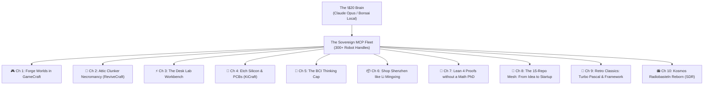

# The Young Dev's Illustrated Primer to Sovereign Agentic Wizardry
*(Or: A Guide for the Perplexed on How to Wield a 300-Repo Fleet with a \$20 Claude Account)*

> *"In the olden days (circa 2023), developers spent forty hours a week typing boilerplate syntax, wrestling with webpack configs, and arguing on Stack Overflow about missing semicolons. Today, you are an air-traffic controller of synthetic cognition. You sit in your workshop with an RTX 4090, a humble \$20/mo model account, and a fleet of robot-handles. Here is how you live like a 21st-century sorcerer without burning VC money."*

---

---

## Chapter 1: Conjure a Living World in `gamecraft`
*“You don’t code pixels. You direct a simulation.”*

You want to make a game. In the old world, you'd spend three months watching Godot shader tutorials and fighting import pipelines. 
In the sovereign fleet, you open Claude, point it at **`gamecraft`** (and its siblings `godot-mcp` + `blender-mcp`), and say:
> *"Spawn a procedural low-poly dungeon, scatter 50 physics crates with PBR wood shaders, wire an orbit camera with WASD dampening, and export an HTML5 WebAssembly bundle."*

Before your espresso cools down, the agent drives Godot’s scene tree via MCP tools, constructs the node hierarchy, assigns PBR textures from GIMP, spins up GPU particle embers, and hands you a playable local web link. You are no longer a typist; you are the lead director of an automated studio.

---

## Chapter 2: Attic Necromancy with `reversing-mcp` *(The Artist Formerly Known as ReviveCraft)*
*“That dusty 1998 CD-ROM from your uncle's attic is not dead. It is just sleeping.”*

You found a forgotten 16-bit Windows game or a proprietary industrial binary from 2002 whose vendor went bankrupt during the Bush administration. The file format is completely undocumented, binary blobs refuse to boot, and modern Windows spits out compatibility errors.

**Enter `reversing-mcp`:**
1. Point Claude at the raw `.exe` or `.dki` file with `analyze_binary` and `extract_strings`.
2. The agent drives headless Ghidra behind the scenes, cross-referencing function addresses, resolving DLL import tables, and decompiling obfuscated C loops into readable pseudocode.
3. The LLM reads the decompiled disassembly: *"Aha! Offset 0x00401A20 expects an obsolete 8-bit palette buffer."*
4. It writes a modern Rust compatibility shim or Python extractor in 90 seconds. The clunker lives again.

---

## Chapter 3: The Frankenstein Maker Bench
*(Multimeter, Oscilloscope, Logic Analyzer, Power Supply)*

You want to build real physical hardware, but you don't have a \$50,000 Keysight laboratory rack. What you do have is a \$40 USB multimeter, a \$60 handheld digital oscilloscope, and a Raspberry Pi. Where did you leave that script again?

Don't panic. The bench is unified:
* **`multimeter-mcp`** (`dmm_run`): Measures real DC voltage and checks circuit continuity.
* **`oscilloscope-mcp`**: Captures raw signal waveforms and feeds them straight to Claude to diagnose ripple noise.
* **`logic-analyzer-mcp`**: Sniffs SPI/I2C packet bytes off the pins in real-time.
* **`power-supply-mcp`**: Sets voltage limits and guards against fried circuits.

You clip the leads to a mystery board, tell Claude: *"Watch pin 4. Ramp the voltage from 3.3V to 5V and tell me when the microcontroller starts emitting serial packets."* Claude monitors the USB telemetry, graphs the waterfall, and tells you: *"Serial output detected at 115200 baud on 4.8V. We're in."*

---

## Chapter 4: Etch Real PCBs with `kicad-mcp` *(KiCraft)*
*“Why breadboard when you can spin real copper?”*

You designed a custom ESP32 macro-pad. Traditionally, drawing schematics, routing 40 traces, and checking design rules in KiCad takes a weekend of eye-strain.

With **`kicad-mcp`**:
1. You describe the circuit in plain English: *"Connect GPIO 14, 15, and 16 to three Cherry MX switches with 10k pull-up resistors and an OLED display on I2C."*
2. The agent emits valid KiCad schematic S-expressions, places footprints, routes net connections, runs the Design Rule Check (DRC), and spits out production-ready Gerber files.
3. You zip the folder and upload it directly to JLCPCB. Total human design time: 12 minutes.

---

## Chapter 5: The BCI Thinking Cap with `openbci-mcp`
*“Look, ma, no hands!”*

You strap on an OpenBCI Ultracortex headset or a 4-channel EEG headband. It spits out microvolt spikes, alpha waves, and raw biosensor noise that looks like an earthquake seismograph.

Through **`openbci-mcp`**:
* The stream flows into local FastMCP bandpass filters.
* Claude correlates your frontal lobe Alpha/Theta ratio in real-time: *"You are losing focus. Pausing heavy compile jobs and dimming the Hue lamps."*
* Spike detection turns hard jaw-clenches or double-blinks into universal command bus triggers: clench twice to trigger an emergency stop on the Yahboom robot car.

---

## Chapter 6: Shop in Shenzhen Like Your Name is Li Mingxing
*“Why pay 5x Amazon markup for a re-badged sensor?”*

You need ten micro-LIDAR sensors, five mecanum wheels, and a pack of STM32 development boards. Amazon wants \$45 per sensor and two weeks shipping.

With **`prc-shopping-mcp`**:
* Claude navigates 1688 and Taobao directly in fluent Chinese.
* It searches wholesale component registries, compares factory batch prices, filters out drop-shippers, translates customer reviews from domestic electronics hobbyists in Guangdong, and calculates consolidator freight forwarding.
* You acquire the exact industrial components at domestic factory cost. You are sourcing hardware like a seasoned Huaqiangbei local.

---

## Chapter 7: Solve Mathematics Conjectures with `leanforge-mcp`
*“Formal mathematical verification without a PhD.”*

You want to prove a theorem or crack an Eötvös competition math puzzle. You don't know Lean 4 syntax, and type-theoretic dependent calculus makes your head spin.

**The Loop of Truth**:
1. You state the mathematical conjecture in plain English.
2. Claude translates it into a candidate Lean 4 proof file.
3. The real, unsparing Lean compiler evaluates the proof.
4. **Compile error!** The compiler spits out: *`type mismatch at term h1`*.
5. Claude reads the exact compiler feedback, adjusts its hypothesis, and tries again.
6. The loop continues until the Lean compiler outputs zero errors: **Verified True.**

No hallucinations. No bullshit. The LLM supplies the creative intuition; the formal compiler supplies the mathematical guarantee.

---

---

## Chapter 8: The 15-Repo Mesh: From Brain-Spark to Hardware Startup in 48 Hours
*“How one developer out-engineers a 20-person seed-stage robotics company before Sunday night.”*

In the corporate tech world, building an autonomous robotics prototype requires six teams: mechanical engineers doing CAD, simulation researchers in Isaac Gym, firmware devs writing drivers, procurement managers waiting on supplier quotes, and a frontend team building a dashboard.

In the sovereign fleet, **you mesh 15 repos together like Lego bricks** and let the agent orchestrate the entire pipeline:

`mermaid
flowchart TD
  Idea["1. The Prompt: Autonomous Quadruped Sentry"]
  CAD["2. Mechanical CAD: freecad-mcp + qcad-mcp (Parametric STEP & STL 3D-print mounts)"]
  Sim["3. The Virtual Dojo: gazebo-mcp + mujoco-mcp (Physics, torque simulation, balance loops)"]
  VR["4. Twin Teleop: resonite-mcp + vrchat-mcp (Drive in XR with 6DoF VR controllers)"]
  BOM["5. Sourcing & Bill of Materials: prc-shopping-mcp (Shenzhen brushless servos & Taobao factory quotes)"]
  Build["6. Physical Assembly: yahboom-mcp + ros2-mcp (Flash firmware, LIDAR SLAM, first steps)"]
  UI["7. Fleet Command & Startup: fleet-agent-mcp + web_sota (Dark dashboard, telemetry, investor demo)"]

  Idea --> CAD
  CAD --> Sim
  Sim --> VR
  VR --> BOM
  BOM --> Build
  Build --> UI
`

1. **Plan & CAD (reecad-mcp + qcad-mcp)**: Claude generates parametric 3D-printable brackets, motor hubs, and chassis plates in STEP/STL format.
2. **The Physics Dojo (mujoco-mcp + gazebo-mcp)**: Before wasting filament or stripping gears, Claude drops the STL into MuJoCo, simulates joint torques, balances the center of mass, and trains a reinforcement-learning gait controller.
3. **The Virtual Twin (
esonite-mcp)**: Step into a VR headset. The robot is standing in front of you in real-time. Move the joysticks on your VR controllers to test teleoperation and inverse kinematics.
4. **The Sourcing Blitz (prc-shopping-mcp)**: Claude extracts the Bill of Materials (BOM), scans Guangdong suppliers on 1688, finds 8Nm planetary gear actuators at wholesale price, and generates the exact customs order.
5. **Assembly & Drive (yahboom-mcp + devices-mcp)**: You meet at the local robot club on Saturday morning, 3D print the chassis, bolt the motors on, flash the ROS 2 nodes, and speech-mcp says: *"Gait stabilization verified. Robot ready."*
6. **The Pitch (dark-app-factory + demo-vid-mcp)**: By Sunday evening, the web dashboard is live with real-time LIDAR streaming, an automated narrated demo video is rendered, and you have a working hardware prototype ready for demo day.

Total headcount: **1 human, 1 GPU, 15 MCP servers.** Total capital spent: **\ in parts and electricity.**

---

## Chapter 9: Retro-Computing Time Travel: Resurrecting 1980s/90s Junior-Genius Classics
*“Because Turbo Pascal 5.5 in Borland blue, Ashton-Tate Framework, and Deluxe Paint still hit different.”*

Every veteran coder remembers the golden age of desktop craft:
* **Turbo Pascal 5.5 / 7.0**: That glorious royal-blue Borland text-UI with yellow status text that compiled 10,000 lines a second on a 386SX with 4MB of RAM.
* **Ashton-Tate Framework III / IV**: The legendary integrated environment (outliner, spreadsheet, database, word processor, M-language) that ran rings around modern memory-hogging Electron bloatware.
* **Electronic Arts Deluxe Paint II (DPaint)**: The pixel-art god-tier tool on the Commodore Amiga and DOS with cycling color palettes and copper effects.
* **Norton Commander / XTree Gold**: The twin-pane blue kings of keyboard-only file management.

**The Sovereign Retro-Resurrection Loop**:
You don't just run an abandonware emulator in a clunky window. You bridge it into the modern agentic bus via **
eversing-mcp** + **dosbox-mcp**:
1. You feed Claude a forgotten .PAS codebase or ancient .FW3 frame file.
2. The agent launches headless DOSBox or an x86 real-mode emulator via MCP, injects keystrokes, compiles the units, and reads the VGA frame buffer.
3. If you want to bring it to 2026: Claude transpiles the Turbo Pascal procedural units or Framework FRED macros directly into safe, zero-panic Rust with an immediate-mode gui retro-blue theme! You get modern 64-bit binaries that preserve the sacred keyboard shortcuts and aesthetics of 1991.

---

## Chapter 10: Virtual Radiobasteln: The Kosmos Electronic Experimenter Kit Lives Again!
*“Spring terminals, germanium diodes, and MW coil winding in a software-defined world.”*

Anyone growing up in Germany, Austria, or Switzerland (DACH) in the 70s, 80s, or 90s remembers the holy grail in the cardboard box with the blue styrofoam inlay: the **Kosmos Radiomann** (or the Philips EE / Schuco ABC electronic experiment kits). 

You carefully wedged hair-thin copper wire into coiled spring terminals (*Schraubfedern*), hooked up a crystal earphone, tuned a ferrite-rod inductor, and caught the faint crackle of Radio Luxembourg or Österreich 1 out of thin air. No batteries. Pure physics. Pure magic.

**The 21st-Century Virtual Radiobasteln Lab**:
You don't need a soldering iron burning a hole in your carpet to relive the magic. You connect **sdr-mcp** (RTL-SDR software-defined radio) + **multimeter-mcp** + **cv-rack-mcp**:

`mermaid
flowchart LR
  Antenna["Real RF Airwaves (RTL-SDR USB Dongle)"]
  SDR["sdr-mcp (Waterfall, I/Q Demod, DSP)"]
  Synth["vcv-rack-mcp (Modular Patching & Filters)"]
  Audio["Earphone Out (MW/SW DXing in Vienna)"]

  Antenna --> SDR
  SDR --> Synth
  Synth --> Audio
`

1. **Software-Defined Spring Terminals**: Claude acts as your master electrical engineer. You say: *"Let's build an audion receiver with regenerative feedback like in Experiment 42 of the Kosmos manual."*
2. **Real Airwaves, Zero Static**: An \ RTL-SDR USB dongle captures real spectrum. sdr-mcp streams the high-frequency I/Q samples into local DSP filters.
3. **Modular Patching (cv-rack-mcp)**: Claude patches virtual envelope followers, bandpass filters, and heterodyne mixers into VCV Rack 2, generating the authentic warm vacuum-tube or germanium-diode acoustic resonance.
4. **DX Hunting Across the Globe**: You sit in your 9th-district apartment, turn virtual brass dials, and let the agent scan shortwave bands for Morse beacons, aviation ATIS, and distant amateur radio operators. The smell of rosin flux is optional, but the magic is 100% back.

## Epilogue: The Creed of the Sovereign Architect

1. **Own the floor, rent the ceiling**: Run your daily models locally on your GPU for \$0; rent cloud brains only when an Eötvös proof needs raw horsepower.
2. **Never type what an agent can scaffold**: If you are writing boilerplate CRUD or hunting port numbers by hand, you have forgotten your station.
3. **Always verify against ground truth**: Compilers, linters, oscilloscopes, and test suites are your ground-truth oracles. Trust nothing until the green check appears.

*Now go into your workshop and build something impossible.*
