```mermaid
flowchart TD
  Brain["The \$20 Brain<br/>(Claude Opus / Bonsai Local)"]
  Fleet["The Sovereign MCP Fleet<br/>(300+ Robot Handles)"]
  
  Brain --> Fleet
  
  Fleet --> C1["🎮 Ch 1: Forge Worlds in GameCraft"]
  Fleet --> C2["💾 Ch 2: Attic Clunker Necromancy (ReviveCraft)"]
  Fleet --> C3["⚡ Ch 3: The Desk Lab Workbench"]
  Fleet --> C4["📐 Ch 4: Etch Silicon & PCBs (KiCraft)"]
  Fleet --> C5["🧠 Ch 5: The BCI Thinking Cap"]
  Fleet --> C6["📦 Ch 6: Shop Shenzhen like Li Mingxing"]
  Fleet --> C7["📐 Ch 7: Lean 4 Proofs without a Math PhD"]
  Fleet --> C8["🤖 Ch 8: The 15-Repo Mesh: From Idea to Startup"]
  Fleet --> C9["💾 Ch 9: Retro Classics: Turbo Pascal & Framework"]
  Fleet --> C10["📻 Ch 10: Kosmos Radiobasteln Reborn (SDR)"]
  Fleet --> C11["⚡ Ch 11: The Heathkit Dream Lab in Resonite VR"]
  Fleet --> C12["📏 Ch 12: Rechenschieber: From Schoolkid to 4D"]
  Fleet --> C13["📖 Ch 13: Attic Byte, Altair & 1970s BASIC"]
  Fleet --> C14["🎨 Ch 14: Vintage Comics: Wunderwelt & Métal Hurlant"]
  Fleet --> C15["⏳ Ch 15: The Time Machine in the Attic"]
```

# The Young Dev's Illustrated Primer to Sovereign Agentic Wizardry
*(Or: A Guide for the Perplexed on How to Wield a 300-Repo Fleet with a \$20 Claude Account)*

> *"In the olden days (circa 2023), developers spent forty hours a week typing boilerplate syntax, wrestling with webpack configs, and arguing on Stack Overflow about missing semicolons. Today, you are an air-traffic controller of synthetic cognition. You sit in your workshop with an RTX 4090, a humble \$20/mo model account, and a fleet of robot-handles. Here is how you live like a 21st-century sorcerer without burning VC money."*

---

---

## Chapter 1: Conjure a Living World in `gamecraft`
*“You don’t code pixels. You direct a simulation.”*

You want to make a game. In the old world, you'd spend three months watching Godot shader tutorials and fighting import pipelines. 
In the sovereign fleet, you open Claude, point it at **`gamecraft`** (and its siblings `godot-mcp` + `blender-mcp`), and say:
> *"Spawn a procedural low-poly dungeon, scatter 50 physics crates with PBR wood shaders, wire an orbit camera with WASD dampening, and export an HTML5 WebAssembly bundle."*

Before your espresso cools down, the agent drives Godot’s scene tree via MCP tools, constructs the node hierarchy, assigns PBR textures from GIMP, spins up GPU particle embers, and hands you a playable local web link. You are no longer a typist; you are the lead director of an automated studio.

---

## Chapter 2: Attic Necromancy with `reversing-mcp` *(The Artist Formerly Known as ReviveCraft)*
*“That dusty 1998 CD-ROM from your uncle's attic is not dead. It is just sleeping.”*

You found a forgotten 16-bit Windows game or a proprietary industrial binary from 2002 whose vendor went bankrupt during the Bush administration. The file format is completely undocumented, binary blobs refuse to boot, and modern Windows spits out compatibility errors.

**Enter `reversing-mcp`:**
1. Point Claude at the raw `.exe` or `.dki` file with `analyze_binary` and `extract_strings`.
2. The agent drives headless Ghidra behind the scenes, cross-referencing function addresses, resolving DLL import tables, and decompiling obfuscated C loops into readable pseudocode.
3. The LLM reads the decompiled disassembly: *"Aha! Offset 0x00401A20 expects an obsolete 8-bit palette buffer."*
4. It writes a modern Rust compatibility shim or Python extractor in 90 seconds. The clunker lives again.

---

## Chapter 3: The Frankenstein Maker Bench
*(Multimeter, Oscilloscope, Logic Analyzer, Power Supply)*

You want to build real physical hardware, but you don't have a \$50,000 Keysight laboratory rack. What you do have is a \$40 USB multimeter, a \$60 handheld digital oscilloscope, and a Raspberry Pi. Where did you leave that script again?

Don't panic. The bench is unified:
* **`multimeter-mcp`** (`dmm_run`): Measures real DC voltage and checks circuit continuity.
* **`oscilloscope-mcp`**: Captures raw signal waveforms and feeds them straight to Claude to diagnose ripple noise.
* **`logic-analyzer-mcp`**: Sniffs SPI/I2C packet bytes off the pins in real-time.
* **`power-supply-mcp`**: Sets voltage limits and guards against fried circuits.

You clip the leads to a mystery board, tell Claude: *"Watch pin 4. Ramp the voltage from 3.3V to 5V and tell me when the microcontroller starts emitting serial packets."* Claude monitors the USB telemetry, graphs the waterfall, and tells you: *"Serial output detected at 115200 baud on 4.8V. We're in."*

---

## Chapter 4: Etch Real PCBs with `kicad-mcp` *(KiCraft)*
*“Why breadboard when you can spin real copper?”*

You designed a custom ESP32 macro-pad. Traditionally, drawing schematics, routing 40 traces, and checking design rules in KiCad takes a weekend of eye-strain.

With **`kicad-mcp`**:
1. You describe the circuit in plain English: *"Connect GPIO 14, 15, and 16 to three Cherry MX switches with 10k pull-up resistors and an OLED display on I2C."*
2. The agent emits valid KiCad schematic S-expressions, places footprints, routes net connections, runs the Design Rule Check (DRC), and spits out production-ready Gerber files.
3. You zip the folder and upload it directly to JLCPCB. Total human design time: 12 minutes.

---

## Chapter 5: The BCI Thinking Cap with `openbci-mcp`
*“Look, ma, no hands!”*

You strap on an OpenBCI Ultracortex headset or a 4-channel EEG headband. It spits out microvolt spikes, alpha waves, and raw biosensor noise that looks like an earthquake seismograph.

Through **`openbci-mcp`**:
* The stream flows into local FastMCP bandpass filters.
* Claude correlates your frontal lobe Alpha/Theta ratio in real-time: *"You are losing focus. Pausing heavy compile jobs and dimming the Hue lamps."*
* Spike detection turns hard jaw-clenches or double-blinks into universal command bus triggers: clench twice to trigger an emergency stop on the Yahboom robot car.

---

## Chapter 6: Shop in Shenzhen Like Your Name is Li Mingxing
*“Why pay 5x Amazon markup for a re-badged sensor?”*

You need ten micro-LIDAR sensors, five mecanum wheels, and a pack of STM32 development boards. Amazon wants \$45 per sensor and two weeks shipping.

With **`prc-shopping-mcp`**:
* Claude navigates 1688 and Taobao directly in fluent Chinese.
* It searches wholesale component registries, compares factory batch prices, filters out drop-shippers, translates customer reviews from domestic electronics hobbyists in Guangdong, and calculates consolidator freight forwarding.
* You acquire the exact industrial components at domestic factory cost. You are sourcing hardware like a seasoned Huaqiangbei local.

---

## Chapter 7: Solve Mathematics Conjectures with `leanforge-mcp`
*“Formal mathematical verification without a PhD.”*

You want to prove a theorem or crack an Eötvös competition math puzzle. You don't know Lean 4 syntax, and type-theoretic dependent calculus makes your head spin.

**The Loop of Truth**:
1. You state the mathematical conjecture in plain English.
2. Claude translates it into a candidate Lean 4 proof file.
3. The real, unsparing Lean compiler evaluates the proof.
4. **Compile error!** The compiler spits out: *`type mismatch at term h1`*.
5. Claude reads the exact compiler feedback, adjusts its hypothesis, and tries again.
6. The loop continues until the Lean compiler outputs zero errors: **Verified True.**

No hallucinations. No bullshit. The LLM supplies the creative intuition; the formal compiler supplies the mathematical guarantee.

---

---

## Chapter 8: The 15-Repo Mesh: From Brain-Spark to Hardware Startup in 48 Hours
*“How one developer out-engineers a 20-person seed-stage robotics company before Sunday night.”*

In the corporate tech world, building an autonomous robotics prototype requires six teams: mechanical engineers doing CAD, simulation researchers in Isaac Gym, firmware devs writing drivers, procurement managers waiting on supplier quotes, and a frontend team building a dashboard.

In the sovereign fleet, **you mesh 15 repos together like Lego bricks** and let the agent orchestrate the entire pipeline:

`mermaid
flowchart TD
  Idea["1. The Prompt: Autonomous Quadruped Sentry"]
  CAD["2. Mechanical CAD: freecad-mcp + qcad-mcp (Parametric STEP & STL 3D-print mounts)"]
  Sim["3. The Virtual Dojo: gazebo-mcp + mujoco-mcp (Physics, torque simulation, balance loops)"]
  VR["4. Twin Teleop: resonite-mcp + vrchat-mcp (Drive in XR with 6DoF VR controllers)"]
  BOM["5. Sourcing & Bill of Materials: prc-shopping-mcp (Shenzhen brushless servos & Taobao factory quotes)"]
  Build["6. Physical Assembly: yahboom-mcp + ros2-mcp (Flash firmware, LIDAR SLAM, first steps)"]
  UI["7. Fleet Command & Startup: fleet-agent-mcp + web_sota (Dark dashboard, telemetry, investor demo)"]

  Idea --> CAD
  CAD --> Sim
  Sim --> VR
  VR --> BOM
  BOM --> Build
  Build --> UI
`

1. **Plan & CAD (reecad-mcp + qcad-mcp)**: Claude generates parametric 3D-printable brackets, motor hubs, and chassis plates in STEP/STL format.
2. **The Physics Dojo (mujoco-mcp + gazebo-mcp)**: Before wasting filament or stripping gears, Claude drops the STL into MuJoCo, simulates joint torques, balances the center of mass, and trains a reinforcement-learning gait controller.
3. **The Virtual Twin (
esonite-mcp)**: Step into a VR headset. The robot is standing in front of you in real-time. Move the joysticks on your VR controllers to test teleoperation and inverse kinematics.
4. **The Sourcing Blitz (prc-shopping-mcp)**: Claude extracts the Bill of Materials (BOM), scans Guangdong suppliers on 1688, finds 8Nm planetary gear actuators at wholesale price, and generates the exact customs order.
5. **Assembly & Drive (yahboom-mcp + devices-mcp)**: You meet at the local robot club on Saturday morning, 3D print the chassis, bolt the motors on, flash the ROS 2 nodes, and speech-mcp says: *"Gait stabilization verified. Robot ready."*
6. **The Pitch (dark-app-factory + demo-vid-mcp)**: By Sunday evening, the web dashboard is live with real-time LIDAR streaming, an automated narrated demo video is rendered, and you have a working hardware prototype ready for demo day.

Total headcount: **1 human, 1 GPU, 15 MCP servers.** Total capital spent: **\ in parts and electricity.**

---

## Chapter 9: Retro-Computing Time Travel: Resurrecting 1980s/90s Junior-Genius Classics
*“Because Turbo Pascal 5.5 in Borland blue, Ashton-Tate Framework, and Deluxe Paint still hit different.”*

Every veteran coder remembers the golden age of desktop craft:
* **Turbo Pascal 5.5 / 7.0**: That glorious royal-blue Borland text-UI with yellow status text that compiled 10,000 lines a second on a 386SX with 4MB of RAM.
* **Ashton-Tate Framework III / IV**: The legendary integrated environment (outliner, spreadsheet, database, word processor, M-language) that ran rings around modern memory-hogging Electron bloatware.
* **Electronic Arts Deluxe Paint II (DPaint)**: The pixel-art god-tier tool on the Commodore Amiga and DOS with cycling color palettes and copper effects.
* **Norton Commander / XTree Gold**: The twin-pane blue kings of keyboard-only file management.

**The Sovereign Retro-Resurrection Loop**:
You don't just run an abandonware emulator in a clunky window. You bridge it into the modern agentic bus via **
eversing-mcp** + **dosbox-mcp**:
1. You feed Claude a forgotten .PAS codebase or ancient .FW3 frame file.
2. The agent launches headless DOSBox or an x86 real-mode emulator via MCP, injects keystrokes, compiles the units, and reads the VGA frame buffer.
3. If you want to bring it to 2026: Claude transpiles the Turbo Pascal procedural units or Framework FRED macros directly into safe, zero-panic Rust with an immediate-mode gui retro-blue theme! You get modern 64-bit binaries that preserve the sacred keyboard shortcuts and aesthetics of 1991.

---

## Chapter 10: Virtual Radiobasteln: The Kosmos Electronic Experimenter Kit Lives Again!
*“Spring terminals, germanium diodes, and MW coil winding in a software-defined world.”*

Anyone growing up in Germany, Austria, or Switzerland (DACH) in the 70s, 80s, or 90s remembers the holy grail in the cardboard box with the blue styrofoam inlay: the **Kosmos Radiomann** (or the Philips EE / Schuco ABC electronic experiment kits). 

You carefully wedged hair-thin copper wire into coiled spring terminals (*Schraubfedern*), hooked up a crystal earphone, tuned a ferrite-rod inductor, and caught the faint crackle of Radio Luxembourg or Österreich 1 out of thin air. No batteries. Pure physics. Pure magic.

**The 21st-Century Virtual Radiobasteln Lab**:
You don't need a soldering iron burning a hole in your carpet to relive the magic. You connect **sdr-mcp** (RTL-SDR software-defined radio) + **multimeter-mcp** + **cv-rack-mcp**:

`mermaid
flowchart LR
  Antenna["Real RF Airwaves (RTL-SDR USB Dongle)"]
  SDR["sdr-mcp (Waterfall, I/Q Demod, DSP)"]
  Synth["vcv-rack-mcp (Modular Patching & Filters)"]
  Audio["Earphone Out (MW/SW DXing in Vienna)"]

  Antenna --> SDR
  SDR --> Synth
  Synth --> Audio
`

1. **Software-Defined Spring Terminals**: Claude acts as your master electrical engineer. You say: *"Let's build an audion receiver with regenerative feedback like in Experiment 42 of the Kosmos manual."*
2. **Real Airwaves, Zero Static**: An \ RTL-SDR USB dongle captures real spectrum. sdr-mcp streams the high-frequency I/Q samples into local DSP filters.
3. **Modular Patching (cv-rack-mcp)**: Claude patches virtual envelope followers, bandpass filters, and heterodyne mixers into VCV Rack 2, generating the authentic warm vacuum-tube or germanium-diode acoustic resonance.
4. **DX Hunting Across the Globe**: You sit in your 9th-district apartment, turn virtual brass dials, and let the agent scan shortwave bands for Morse beacons, aviation ATIS, and distant amateur radio operators. The smell of rosin flux is optional, but the magic is 100% back.

---

## Chapter 11: The Heathkit Dream Lab: Rebuilding the Unaffordable Crown Jewels in Virtual Reality
*“Daddy said: 'Practice Schönschreiben and use your Rechenschieber! You don't need an Oscillo-Dingus!' Daddy was wrong.”*

Every kid with solder in their blood remembers paging through the glossy pages of a **Heathkit catalog** from 1975, 1982, or 1990:
* The legendary **Heathkit IO-12 / IO-4550 Cathode-Ray Oscilloscopes**: That curved, green phosphor CRT tube glowing in the dark with calibrated graticules and clunky rotary stepped attenuators.
* The **Heathkit SB-104 Transceiver**: The crown jewel of amateur radio stations with die-cast chassis, analog illuminated needle S-meters, and knurled VFO tuning dials.
* The **Heathkit Hero 1 Robot** (1982): That futuristic beige roving companion with a rotating ultrasonic turret and a synthesized robotic voice.

You pleaded with your parents. Daddy pushed your slide rule (*Rechenschieber*) across the kitchen table and said: *“Practice your long division on paper! Nobody makes a living turning knobs on a cathode-ray dingus!”*

### The Sovereign Revenge Loop: The Heathkit VR Retro-Mansion
Thirty years later, you have 13,000 digitized books in your Calibre library, a full stack of CAD tools, and a virtual reality world waiting to be populated. Daddy’s slide rule has been replaced by an agentic compiler loop.

`mermaid
flowchart LR
  Catalog["Heathkit Catalog / Manual (Calibre Library RAG)"]
  CAD["freecad-mcp + blender-mcp (Sheet metal, dials, CRT curvature)"]
  Logic["vcv-rack-mcp + sdr-mcp (Live phosphor sweep, audio heterodyne)"]
  Mansion["Resonite VR Retro-Mansion (Interactive 3D Workbench)"]

  Catalog --> CAD
  CAD --> Logic
  Logic --> Mansion
`

1. **Extract the Ground Truth (calibremcp / calibre-mcp)**: 
   Claude queries the digitized Heathkit schematic and catalog archive: *"Pull the panel dimensions, knob placement, and circuit schematic for the Heathkit IO-4550 oscilloscope and HW-101 transceiver."*
2. **CAD the Metal & Knobs (reecad-mcp + lender-mcp)**:
   Claude models the authentic bent sheet-metal casing, knurled aluminum knobs, toggle switches, and the curved glass vacuum-tube faceplate with realistic PBR brushed-aluminum and hammertone paint materials.
3. **Wire the Phosphor & Circuit Logic (cv-rack-mcp + sdr-mcp)**:
   It’s not a static 3D prop. Claude hooks the virtual CRT screen to real signal shaders in Godot/Resonite. Route a live audio feed or local RTL-SDR radio stream through the virtual input BNC connector, and the green phosphor trace actually dances with realistic beam persistence and deflection jitter!
4. **Step Into Your Virtual Retro-Mansion (
esonite-mcp)**:
   You slip on your VR headset. You are standing in a warm wood-paneled 1970s attic laboratory. On the heavy oak workbench sits the full, glowing Heathkit stack—every meter twitching to live radio signals, every rotary switch clicking with authentic haptic audio feedback.

You can finally turn the dials on the oscillo-dingus. And you didn't have to practice your Schönschreiben to do it.

---

## Chapter 12: The Rechenschieber Demystified: From Schoolkid Sliders to 4D Agentic Slide Rules
*“Daddy’s Faber-Castell slide rule had 18 scales. You only knew C and D. Now, agents can wield hyper-dimensional log rulers with infinite precision.”*

Every kid in the DACH school system was handed a white bamboo or plastic slide rule (a Faber-Castell 2/83N, Aristo 0903, or Nestler). 
It felt like holding an alien artifact from 1968. You slid the middle runner back and forth, aligned the transparent cursor hairline, multiplied .4 \times 3.5$, got roughly .4$, and then squinted at the tiny marks on the edges wondering: *“What on earth are LL3, CI, K, and L doing here?”*

---

### Part 1: The Schoolkid Basics (Logarithmic Addition)
A slide rule doesn't do arithmetic; it **adds distances**. Because logarithms turn multiplication into addition:
\log(A \times B) = \log(A) + \log(B)

* **The C & D Scales (Everyday Multiplication & Division)**: Identical logarithmic scales from 1 to 10. Slide 1 on scale C to 2 on scale D. Now look at 3 on scale C—it points directly at 6 on scale D. Boom: physical analog computation.
* **The CI Scale (Inverted C)**: Reads backwards from right to left (/x$). Multiply three numbers in a single cursor alignment without moving the slide twice!

### Part 2: The Esoteric Scales Professor Kleverling Never Explained
On high-end engineering rules, the surface was packed with cryptic letter codes:
* **A & B Scales (^2$)**: Two decades squeezed into the same length. Move your cursor hairline on D to 3; read 9 straight off A.
* **K Scale (^3$)**: Three decades compressed into the length. Immediate cube roots without touching paper.
* **LL1, LL2, LL3 (Log-Log Scales)**: The arcane beasts of chemical and nuclear engineering. They compute exponential powers like .045^{17.8}$ or half-lives:
  \log(\log(y))
  By taking the logarithm *twice*, arbitrary exponentiation ( = x^a$) becomes simple distance addition!
* **P (Pythagorean Scale)**: Gives $\sqrt{1 - x^2}$ directly for electrical phase power factors without trigonometry.

---

### Part 3: The 3D Interactive Web Demo (	hree.js)
In our companion dashboard, the agent doesn't simulate numbers with rounding errors—it builds an interactive 3D bamboo-and-celluloid slider rule with WebGL shaders:
* **The Cursor Glass**: An illuminated glass shader with a glowing red hairline.
* **Raycast Physics**: Click and drag the runner slide; hear the smooth wooden friction sound.
* **Floating Holographic Ticks**: Cursor hovering over any mark displays the exact floating-point value, logarithmic distance, and mathematical derivation.

---

### Part 4: The Mind-Bending Leap: The N-Dimensional Agentic Slide Rule
*“Why keep a slide rule flat when agents think in 1536-dimensional embedding space?”*

In 1620, William Oughtred invented the slide rule by sliding two 1D logarithmic sticks against each other. 
In 2026, an AI agent working with our fleet can generalize the slide rule into **arbitrary dimensions**:

`mermaid
flowchart TD
  D1["1D Classical: Linear Sticks (log A + log B = log C)"]
  D2["2D Circular / Cylindrical: Otis King / Fuller (Spiral scale with 84 feet of resolution)"]
  D3["3D Spatial: Resonite Gyro-Rule (Concentric sliding nested geodesic spheres)"]
  DN["N-D Agentic Manifold Ruler (Vector dot-product projections with infinite precision)"]

  D1 --> D2
  D2 --> D3
  D3 --> DN
`

1. **Circular & Cylindrical Rules (Otis King / Fuller)**: Wrapping the logarithmic line into a spiral gives an effective 15-meter scale in your pocket.
2. **The 3D Resonite Gyro-Rule**: In virtual reality, nested, transparent concentric spheres slide and rotate along Euler axes. Aligning two rotational coordinates computes matrix transformations and spatial quaternion rotations with physical touch!
3. **The Infinite-Precision Agentic Manifold**: An agent doesn't need to squint at physical tick marks. An N-dimensional slide rule represents hyper-planes sliding across high-dimensional latent vectors. It computes cosine similarities and tensor contractions as geometric distances on an analog geometric manifold.

Daddy wanted you to use your Rechenschieber. So we gave it to the agents, gave it infinite precision, and projected it into 4D space.

---

## Chapter 13: Attic Archaeologist: Savoring 1970s *Byte*, *Popular Electronics*, & Homebrew BASIC
*“Robert Tinney’s surreal covers, the Altair 8800 breakthrough, and typing in 500 lines of spaghetti BASIC.”*

Up in the attic, inside cardboard banana boxes smelling of dry dust and aged paper pulp, lies the true sacred scripture of our tribe:
* **The Legendary January 1975 *Popular Electronics***: The cover that launched personal computing—an artist's painting of the **Altair 8800** with toggle switches and red LEDs, whispering to every hobbyist: *“Project Breakthrough! World’s First Minicomputer Kit to Rival Commercial Models... Save over \!”*
* **The Golden Age of *Byte* Magazine (1975–1985)**: Those sublime, whimsical, surrealist watercolor covers by **Robert Tinney**—floppy disks as flying saucers, microprocessors as ancient Greek temples, and tiny robotic figures building castles out of silicon wafers.
* **The Homebrew Computer Club Spirit**: Gordon French’s garage in Menlo Park; Lee Felsenstein moderating; Steve Wozniak handing out schematics on loose-leaf paper because information wanted to be free.

### The Modern Resurrection Pipeline: From Yellowed Pulp to Interactive Code
With **ocr-mcp** + **calibremcp** + **dosbox-mcp**:
1. **Pulp to Token (ocr-mcp)**: Feed the agent scans of old, smudged magazine pages. Modern vision models extract the magazine articles, strip the 1978 mail-order ads for 1KB static RAM boards (\!), and transcribe the raw BASIC type-in listings with zero typo drift.
2. **Smile at the Predictions**: Let Claude contrast 1981 editorial predictions (*“Why 640K will satisfy desktop memory for a generation”*) against our current 24GB VRAM reality on Goliath.
3. **Run the 1979 Type-In Game**: Claude pipes the transcribed BASIC code directly into an emulated Microsoft BASIC / GW-BASIC runtime. Within seconds, you are playing *Lunar Lander* or *Hamurabi*, complete with authentic uppercase prompt nostalgia: HOW MANY BUSHELS OF GRAIN DO YOU WISH TO FEED YOUR PEOPLE?

---

## Chapter 14: The Pulp Renaissance: Reviving Vintage Comics, *Wunderwelt*, & *Métal Hurlant*
*“From Austrian childhood fairy tales to Moebius's wild sci-fi neon dreams.”*

Tucked right beside the technical journals in the attic trunk was the visual nourishment of your youth:
* **The DACH Childhood Treasury: *Wunderwelt* & *Kiddie Comics***: Those gentle, beautifully illustrated mid-century Austrian magazines (*Die Wunderwelt*, 1948–1986)—tales of forest sprites, whimsical clockwork toys, and cozy illustrated puzzles that taught generations of children how to wonder before screens took over.
* **The Sci-Fi Revolution: *Métal Hurlant* & *Heavy Metal* (1975+)**: The earth-shattering arrival of Moebius (Jean Giraud), Philippe Druillet, and Enki Bilal. Gone were the sterile superheroes; in came gritty, cosmic, psychedelic cyberpunk landscapes, bio-mechanical flying galleons, and existential neon odysseys that inspired *Blade Runner* and *Alien*.

### The AI Comic Conservator & Digital Diorama Pipeline
How does a sovereign fleet treat vintage illustrated art?
* **Deep Restoration (ocr-mcp + photocraft)**: AI extracts comic panels from vintage yellowed scans, cleans ink bleed-through, de-mottles pulp paper, and reconstructs the authentic offset-print halftone dot matrix (*Ben-Day dots*) with pristine high-DPI clarity.
* **From 2D Panel to 3D Metaverse (lender-mcp + 
esonite-mcp)**: 
  Take Moebius’s floating desert gliders from *Arzach* or the whimsical fairy-tale cottages of *Wunderwelt*. Claude parses the line art, drives Blender to generate depth-displaced 3D mesh geometry, textures it with procedural watercolor or airbrush shaders, and deploys it as an explorable, walk-through diorama inside Resonite VR.

You don't just read the comic on a flat tablet. You step into the panel, feel the alien desert breeze, and watch the twin suns set over Moebius's horizon.

---

## Chapter 15: The Time Machine in the Attic: Reconstructing Your Younger Self & Family Lore
*“Yellowed Agfacolor slides, reel-to-reel tape hum, Super 8 film flicker, and handwritten school diaries—rebuilt on your own silicon without corporate vultureware.”*

Dodgy Silicon Valley startups and corporate subscription apps promise to *"resurrect your loved ones with AI"*—for \.99 a month, with your family’s most sacred memories uploaded to a third-party server, scraped for advertising profiles, and locked behind a paywall.

**We reject that completely.** 

Your memories belong to you. Your childhood voice on a magnetic tape, your dad’s laugh recorded on a 1/4-inch open reel in 1978, the faded Agfa and Kodak slides, and the silent flicker of Super 8 home movies belong on your sovereign local machine. With our fleet, you can build a **private, offline time machine** that reconstructs your past with forensic beauty, privacy, and profound respect.

`mermaid
flowchart TD
  Attic["Artifacts in the Trunk (Slides, 1/4-Inch Tape, Super 8, Diaries)"]
  FleetIngest["Fleet Restoration Pipeline (immich + demucs + whisper + ocr)"]
  NeuralSynth["Local Sovereign Synthesis (Style-transfer, F5-TTS, Video Temporal Restoration)"]
  Encounter["The Private Encounter (Interactive Resonite VR Living Room or Local Memory RAG)"]

  Attic --> FleetIngest
  FleetIngest --> NeuralSynth
  NeuralSynth --> Encounter
`

---

### 1. Visual Forensic Restoration (immich-mcp + Local Vision Models)
* **The Scan Ingestion**: Cardboard boxes of 35mm slides, paper prints with scalloped edges, and pocket Instamatic prints are ingested into **immich**.
* **Pristine De-Aging**: Local models strip silver-halide mold, dust scratches, and the dreaded orange/magenta shift of aged Agfacolor dyes, restoring the vibrant original greens of an Austrian meadow and the crisp blues of a 1974 summer sky.
* **Temporal & Spatial Sleuthing**: 
  * *When was this taken?* Claude inspects car license plates (black Austrian plates with white regional lettering), fashion silhouettes, furniture laminate styles, and background architecture.
  * *Where was this?* By comparing mountain ridgelines, church spires in the background, and street signs against public geo-spatial data, the agent pinpoints: *“St. Gilgen, Wolfgangsee, likely July 1976.”*

---

### 2. The Voice on the Magnetic Tape (speech-mcp + Demucs + Whisper)
In the bottom of a shoe box lies a 5-inch spool of BASF or AGFA magnetic tape. You threaded it onto a reel-to-reel deck and recorded yourself as a seven-year-old singing a silly nursery rhyme with your dad joking in the background.

* **Audio Forensic Cleaning (mixx-dj-mcp / Demucs)**: Local neural stem separation isolates the tape hum, 50Hz mains buzz, and mechanical capstan rumble from the vocal frequencies.
* **Transcript & Cadence Recovery (speech-mcp / Whisper)**: Local Whisper transcribes the spoken Austrian dialect words, catching regional colloquialisms that commercial speech-to-text engines choke on.
* **Voiceprint Preservation**:
  * You can clone your own childhood voiceprint (it's your biological identity—zero privacy concerns!) or dad's warm timbre into a local voice model (like F5-TTS or XTTS running on the RTX 4090).
  * You can ask questions to a local knowledge base fed on your dad’s old letters and diaries, and hear the answer spoken in the exact acoustic warmth of that 1978 tape.

---

### 3. The Super 8 Film Upscaler & Temporal Interpolation
That 3-minute silent Super 8 reel of family vacations running at 18 frames per second:
* Claude orchestrates frame-by-frame stabilization, grain management, and motion interpolation to restore smooth 24/60fps cadence without synthetic smoothing artifacts.
* Sound design: Pairing ambient soundscapes (gentle summer wind, distant lake lapping) to breathe presence into silent celluloid.

---

### 4. Handwritten Diaries & Letters (ocr-mcp + dvanced-memory-mcp)
A faded checkered notebook with primary-school cursive:
* Modern multimodal vision models decipher vintage handwriting styles (even Kurrent or Sütterlin if browsing your grandparents' generation).
* Ingested directly into **dvanced-memory-mcp**: The agent builds a **personal biographical timeline** mapping school grades, childhood best friends, first pets, holiday trips, and teenage dreams.

---

### 5. Stepping Into 1979 in Resonite VR
You take the 3D living room layout from the background of five different Christmas photos, reconstruct the wallpaper pattern, the orange corduroy armchair, and the wooden Philips television set in Blender via **lender-mcp**, and deploy it to **
esonite-mcp**.

You put on your VR headset. 
You are sitting in the warm glow of your childhood living room. On the record player, the family reel-to-reel tape is spinning on the shelf. The Super 8 home movie flickers against the wall. And across the table, your younger self looks up with eyes full of curiosity about the future.

No cloud subscription. No telemetry leaving your home. Just an engineer, an RTX 4090, and a heart full of memory.

> 💡 **For the mathematically fearless:** If your brain craves the rigorous academic history, Hilbert's 13th Problem, Kolmogorov-Arnold Representation Theorem, and Hyperdimensional Computing (HDC), see the companion research paper: **[The Theory of Higher-Dimensional Slide Rules](THEORY_OF_HIGHER_DIMENSIONAL_SLIDE_RULES.md)**. Junior devs may safely skip this to prevent their lids from flipping!

---

## Epilogue: The Creed of the Sovereign Architect

1. **Own the floor, rent the ceiling**: Run your daily models locally on your GPU for \$0; rent cloud brains only when an Eötvös proof needs raw horsepower.
2. **Never type what an agent can scaffold**: If you are writing boilerplate CRUD or hunting port numbers by hand, you have forgotten your station.
3. **Always verify against ground truth**: Compilers, linters, oscilloscopes, and test suites are your ground-truth oracles. Trust nothing until the green check appears.

*Now go into your workshop and build something impossible.*
