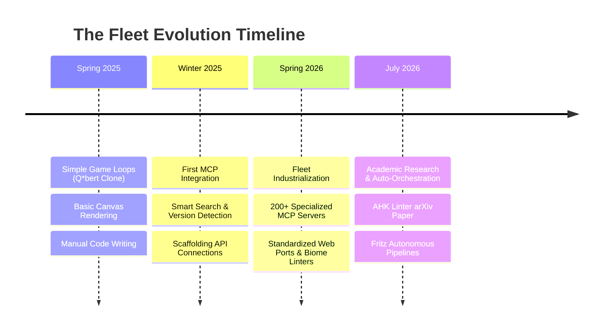

# Evolution of the Agentic Fleet (Spring 2025 — Mid 2026)
**Meta-Analysis of System Complexity and Tooling Sophistication**

---

---

## 📈 1. Phase-by-Phase Complexity Analysis

### Phase 1: Spring 2025 — The Desktop Canvas Era (Q*bert Clone)
* **Objective**: Recreating classic arcade mechanics (isometric tile jumps, score tracking, basic enemy state machines) using HTML Canvas and native JavaScript.
* **Architecture**: Monolithic, synchronous, front-end only, executing in standard browser sandboxes.
* **Human-AI Interaction**: Linear code generation. The LLM acts as an assistant writing functions; the human manually copies, pastes, runs, and troubleshoots runtime errors.

### Phase 2: Winter 2025 — The First MCP Bridges
* **Objective**: Connecting local resources and media libraries to AI agents via Model Context Protocol.
* **Architecture**: Client-server architectures using early FastMCP frameworks. Introduction of JSON-RPC communication pipes.
* **Complexity Level**: Handled basic photo query routing and simple folder scans, but lacked version adaptation, state management, or linter checking.

### Phase 3: Spring 2026 — The Industrialized Fleet
* **Objective**: Scaling to 200+ specialized MCP servers, standardizing ports, and creating a unified web dashboard system.
* **Architecture**: 
  - Standardized web ports (`10794`/`10795` registries).
  - Introduction of strict code-quality gates (Ruff for Python, Biome for JS/TS).
  - Purification of the JSON-RPC stream (purging stdout print messages to prevent protocol corruption).
* **Human-AI Interaction**: Agentic workflows. The agent can self-lint, auto-build Vite assets, and check package dependencies.

### Phase 4: Mid-2026 — Research & Autonomous Pipelines (Fritz & ahk-lint)
* **Objective**: Moving beyond tool building into academic analysis, compiler research, and cross-agent workflow orchestration.
* **Key Milestones**:
  - **`ahk-linter` & arXiv Paper**: Formalizing compiler design and evaluating LLM code repair capabilities against a corpus of **189K LOC**. This moves the fleet from pure software engineering into software science.
  - **Fritz / Fleet Automation Agents**: Developing pipelines (`fritz-pipeline-test`) that autonomously trigger cross-mcp actions (e.g., retrieving coordinates, running compilers, spawning assets in VR).
* **Human-AI Interaction**: High-level goal delegation. The human provides a goal (e.g., *"recreate my room"* or *"status check"*); the agent autonomously launches subprocesses, manages tasks, and generates status pages.

---

## 🛠️ 2. Core Technological Shift

| Aspect | Spring 2025 (Q*bert) | July 2026 (Fritz & AHK Linter) |
|--------|----------------------|---------------------------------|
| **Execution Paradigm** | Sync, Single-Threaded JS | Async Concurrent, Multi-Agent Orchestration |
| **Tooling Quality** | Webpack/npm Defaults | Biome-CI, Bun Migration, Ruff-Strict, `uv` Lockfiles |
| **Agent Autonomy** | Pure Generation (Code Sandbox) | Agentic Feedback Loop (Lint -> Self-Correct -> Build) |
| **System Scope** | Isolated Browser Game | Federated MCP Ecosystem (Imich, Resonite, ArXiv, Fritz) |
| **Affiliation & Impact** | Personal/hobby scripts | Formal research contributions (arXiv/JOSS preprints) |

---

## 🎯 3. Meta-Analysis Insights

* **The Code-to-System Shift**: In 2025, the focus was on *writing code*. In 2026, the focus is on *writing systems that evaluate and correct code*.
* **The SOTA Standardization Dividend**: Standardizing on FastMCP and formatting tools (Ruff, Biome, Bun) is what enabled scaling from a few tools to over 200 servers. Without strict formatting rules and automated pipelines, the fleet would have collapsed under dependency drift.
* **The Agentic Loop**: The true leap forward is **self-correction**. By wrapping linters in MCP interfaces, agents now possess a feedback loop that mirrors compiler-driven human development, resulting in 100% fix rates for generated code.
