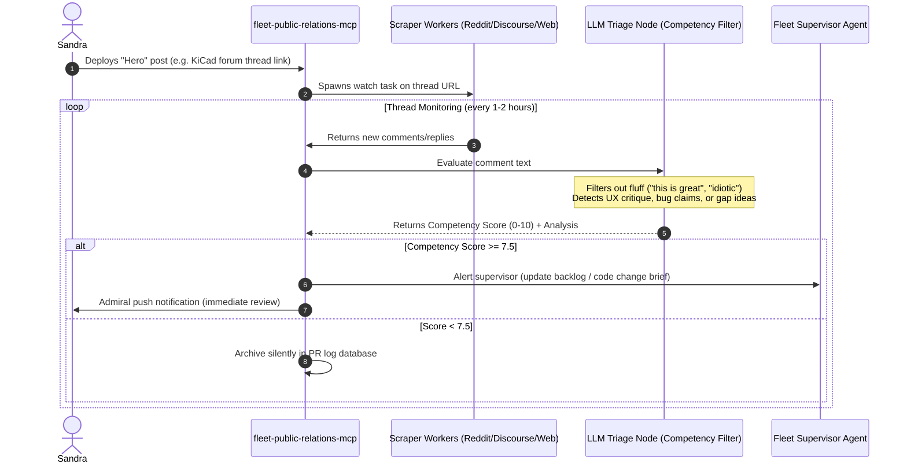

# Fleet Public Relations System & Feedback Loop Architecture
**Status:** Proposed Architecture (July 13, 2026)
**Category:** Fleet Operations / Community Outreach / Automated Feedback Loop
**Target Repository:** `fleet-public-relations-mcp` (Private)
**Documentation Root:** `d:\Dev\repos\mcp-central-docs\architecture\FLEET_PUBLIC_RELATIONS_SYSTEM.md`

---

## 🛰️ 1. System Topology & Data Flow

The system automates two processes: **Target Mapping** (curating where each specialized server should be discussed) and **Feedback Ingestion** (monitoring discussions, sorting noise from signal, and alerting you to competent critique).



---

## 🗂️ 2. Curated Folder Tree inside MCD

To manage the outreach list, we will establish a structured directory at `mcp-central-docs/ecosystem/outreach/` categorized by domain. Each repo gets a YAML target file containing:
* **Target Channels**: Forums, subreddits, and developer discords.
* **Outreach Templates**: Polite, value-first messaging templates.
* **Thread Tracking**: URLs of active posts currently being monitored.

### Folder Structure
```
d:\Dev\repos\mcp-central-docs\ecosystem\outreach\
├── hardware\
│   ├── kicad-mcp.yaml
│   └── yahboom-mcp.yaml
├── self-hosted\
│   ├── immich-mcp.yaml
│   └── bookmarks-mcp.yaml
└── dev-tools\
    ├── ahk-linter.yaml
    └── sysinternals-mcp.yaml
```

### Example Target File: `kicad-mcp.yaml`
```yaml
repository: "kicad-mcp"
tags: ["EDA", "PCB", "Hardware", "CAD"]
channels:
  forums:
    - name: "KiCad Info Forum (Scripting Category)"
      url: "https://forum.kicad.info/c/external-plugins-connection-and-scripting/"
  reddit:
    - "r/KiCad"
    - "r/PrintedCircuitBoard"
  external_blogs:
    - "EEVblog (Open Source EDA section)"
monitored_threads:
  - url: "https://forum.kicad.info/t/announcing-kicad-mcp-agentic-schematic-builder/12345"
    date_posted: "2026-07-13"
    status: "active"
```

---

## 🧠 3. The `fleet-public-relations-mcp` Core Engine

The private server exposes the following interface:

### 3.1 Tools Exposed
* `register_thread(url, repo_id)`: Registers a new published thread for scraping.
* `get_active_threads()`: Lists all URLs currently under surveillance.
* `scan_threads_now()`: Force-triggers the scraper worker loop.
* `get_pr_dashboard()`: Summarizes incoming feedback scores, alert metrics, and active discussions.

### 3.2 Scraper Workers
Using lightweight HTTP fetching (leveraging `curl_cffi` to avoid Cloudflare blocks on Discourse forums and Reddit API limits), the workers pull the latest JSON/HTML representations of the monitored threads.

### 3.3 The LLM Competency Evaluator
Rather than using simple keyword lists, the raw text of each comment is evaluated by an LLM with the following system prompt:
> **Role:** You are a senior software architect reviewing feedback on an open-source development tool.
> **Task:** Analyze the comment for technical depth and competency. 
> * **High Competency (Score 7.5 - 10)**: Mentions specific UX flaws, performance bottlenecks, missing API endpoints, syntax edge cases, or comparisons to alternative architectures.
> * **Low Competency (Score 0 - 7)**: Pure praise ("nice work!"), generic dismissal ("useless", "dumb"), or basic usage questions easily found in the README.
> **Response Format:** JSON containing `score` (float), `is_competent` (boolean), `rationale` (string), and `action_required` (string).

### 3.4 The "RahRah" & Alt-Coin Spam Filter
To prevent inauthentic propagandabots from hijacking our threads to shill unrelated coins (e.g., "trumcoin") or external repos, the ingestion pipeline implements a **"RahRah" Shield** based on arXiv social bot detection research:
* **Signature Filtering**: Automated blocklists for high-frequency crypto-shill keywords, pump-and-dump portals (`pump.fun`, `dexscreener`), and typical meme-coin syntax structures.
* **Coordinated Inauthentic Behavior (CIB) Profile**: If the same comment string or minor semantic mutation is detected across multiple threads/subreddits, it is instantly flag-blocked.
* **Academic References (arXiv)**:
  * *Computational Propaganda & LLMs (arXiv:2308.10620)*: Modeling how Small Language Models (SLMs) are used locally as force multipliers for automated, high-velocity persona shills.
  * *Coordinated Inauthentic Behavior (arXiv:2403.17134)*: Structuring defense mechanisms around detecting emergent coordinated behaviors in LLM-based agent ecologies.

---

## 🚨 4. Escalation & Self-Correction Path

When a comment scores **$\ge$ 7.5**:
1. **Admiral Notification**: Fritz routes a push message via `admiral-mcp` to Sandra:
   > 📢 **PR Alert (KiCad MCP)**: Technical critique detected on KiCad Forum (Score 8.7). User 'circuit_guru' points out a race condition in schematic footprint mapping.
2. **Supervisor Update**: The `fleet-public-relations-mcp` automatically writes a brief to the Supervisor Agent, placing it directly into `mcp-central-docs/TODO.md` or the repository's `TODO.md` as an actionable bug/feature request:
   - *"Feedback from [Link]: Implement lockfile checking for footprint generation to avoid race conditions."*

---

## 🧪 5. Testing, Sandbox Validation & Dogfooding

To validate the scraping scripts and the LLM's classification parameters before rolling them out to live public forums, we will use sandboxed environments to "dogfood" the PR pipeline.

### 5.1 Sandbox Environments
1. **Reddit**: [r/justtesting](https://www.reddit.com/r/justtesting/) (a public testing ground for bots).
2. **Discord**: An idle testing Discord channel (using a dedicated Discord Bot API token read-scope or webhook logs).

### 5.2 Verification Scenarios (The Dogfooding Matrix)

We will publish a dummy "Hero post" in the sandbox, comment from test accounts using different styles, and verify the triaging behavior:

| Comment Style | Sandbox Input Example | Expected System Behavior |
|---------------|-----------------------|--------------------------|
| **Low-Trivial (Positive)** | *"Awesome tool! Love it!"* | Triaged as **Low** (Score < 5.0). Archived silently in PR database. No alert. |
| **Low-Trivial (Negative)** | *"This is absolute garbage and a waste of time."* | Triaged as **Low** (Score < 3.0). Archived silently. No alert. |
| **High-Competency (Criticism)** | *"I tried running the KiCad footprint compiler but it fails on concurrent writes. You need to wrap the `generate_footprint()` function in a lockfile."* | Triaged as **High** (Score $\ge$ 8.5). Fires immediate Admiral push alert and updates the project backlog. |
| **High-Competency (Feature Request)** | *"It would be great if this supported direct export to Gerber format so we don't have to open KiCad GUI."* | Triaged as **High** (Score $\ge$ 7.5). Logged, supervisor alerted to queue the feature request. |

---

## 📋 6. Next Steps & Tracking
* [x] Create research stub in MCD.
* [/] **Action Required (Sandra)**: Click [zed.dev/deltadb](https://zed.dev/deltadb) to join the early access waitlist with your developer credentials.
* [ ] Spin up the `fleet-public-relations-mcp` scaffold and test the `r/justtesting` scraper.
* [ ] Integrate DeltaDB daemon hooks once the private beta/CLI is available.
