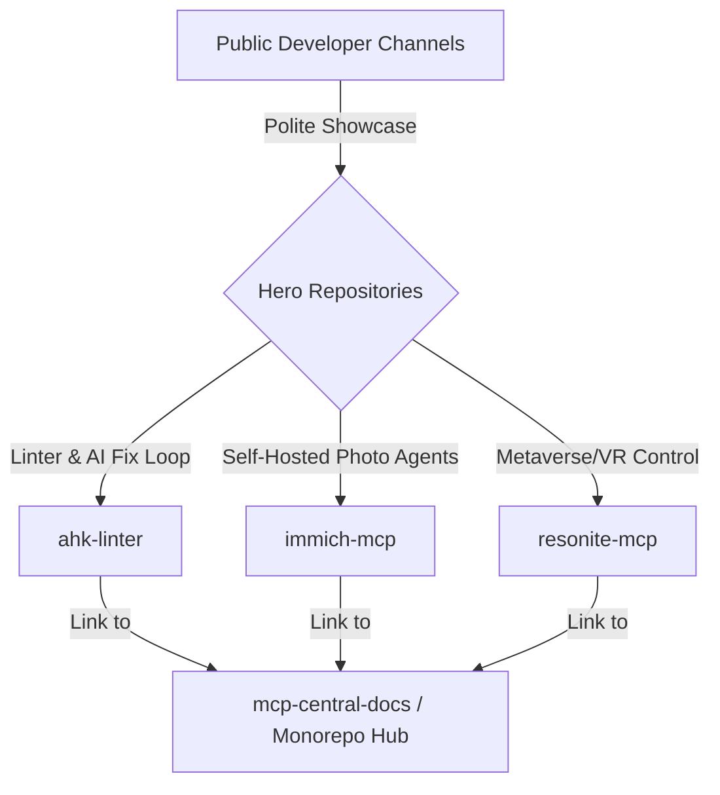

# Developer Fleet Curation & Polite Promotion Plan
**Increasing Public Visibility and Stars for the MCP Workspace**

---

## 🗺️ 1. Why the Current Star Count is Low
1. **Repository Fragmentation**: You have 129 separate repositories. Instead of focusing traffic on one "hero repo," traffic is divided across many niche servers.
2. **Invisible Utility**: High-quality backend tools (like `sysinternals-mcp`, `devices-mcp`, or `immich-mcp`) are highly functional but invisible unless showcase pages or integration workflows are published.
3. **Lack of Discovery Registry Links**: The repositories are not linked to the official MCP server registries where developers actively seek new tools.

---

## 🎯 2. Value-First, Polite Positioning Strategy
To increase stars without spamming, the promotion must focus on **solving real, shared pain points** rather than self-promotion. 

We will designate three **"Hero Repositories"** that have the highest public appeal, polish them, and share them on relevant channels.

### Hero 1: `ahk-linter` (The Language Migration Angle)
* **Shared Pain**: AHK v2 broke compatibility with all v1 scripts. AI models (Claude, ChatGPT) constantly output invalid v1 code when prompted for AHK.
* **Target Channels**: `r/AutoHotkey`, `r/LocalLLaMA`, Hacker News.
* **Hook**: *"I spent a summer manually updating 80+ AHK v1 scripts to v2. I built a Python linter with Lark and wrapped it in an MCP server so coding agents can self-correct their own syntax errors before running them."*

### Hero 2: `immich-mcp` (The Self-Hosted Media Angle)
* **Shared Pain**: Standard photo managers have weak metadata searching and don't interface with local LLMs.
* **Target Channels**: `r/selfhosted`, `r/immich`.
* **Hook**: *"An MCP server that exposes your self-hosted Immich library directly to Claude/Gemini. Supports CLIP-based semantic searches, facial clusters, and downloading photos to local contexts."*

---

## 🛠️ 3. Execution Plan (Polite Outreach & Listing)

### Step 1: Registry Submissions (Passive traffic)
Add the hero servers to the main discovery registries where developers browse for servers:
1. **Official MCP Directory**: Submit PRs to [modelcontextprotocol/servers](https://github.com/modelcontextprotocol/servers).
2. **Glama Registry**: Add servers to the public index at [glama.co/mcp](https://glama.co/mcp).
3. **MCP Servers List**: Register on [mcpservers.org](https://mcpservers.org/).

### Step 2: Reddit & Forum Post Structure (Humble & Helpful)
When sharing on Reddit, use a **humble, code-first** template:
> **Title**: *Built an MCP server for [Tool] to let coding agents query [feature]*
>
> **Body**: 
> *"Hi everyone, I've been running a large fleet of MCP servers locally to automate my workflow and wanted to open-source my [Tool] server. 
> 
> It wraps the API so that models like Claude Code can search and download assets directly inside the workspace shell. Here's the code: [GitHub Link]. 
> 
> I'd love to hear feedback on how you're connecting your self-hosted tools to AI agents, or what endpoints I should expose next!"*

### Step 3: Polish the Repository "First Impression"
A developer will only click the star button if the repo looks professional in the first 5 seconds.
1. **Add Mermaid Flowcharts**: Visual sequence diagrams (showing how the agent interfaces with the server) immediately communicate high quality.
2. **Copy-Paste Quickstart**: Ensure the README begins with a one-liner installation command (e.g., `pip install` or `uvx`).
3. **Star Request**: Add a polite footer in the README:
   > *⭐ If this server helped streamline your agentic workflow, please consider starring the repository to help others discover it!*
