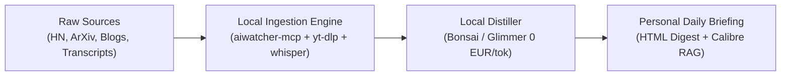

# High-Signal Radar: Sovereign Ingestion & Distillation Protocol

**Context**: How to cut through vendor marketing, hype loops, and cognitive fatigue without wasting hours watching 40-minute videos or doomscrolling aggregator feeds.

---

## The Core Philosophy: "Own the Ingestion, Let the LLM Read"
The goal of high-signal tracking is **asymmetric knowledge acquisition**: spend 10 minutes skimming structured, distilled signal instead of 3 hours watching filler.



---

## 1. Daily & Weekly Reading Stack

### Tier 1: Real Builders & Thinkers (High Signal)
* **Simon Willison's Weblog** ([simonwillison.net](https://simonwillison.net)): The definitive voice on agentic engineering patterns, LLM security (prompt injection), and sqlite/tools.
* **Hacker News (Algolia API / Top Distill)**: Trawled automatically by `aiwatcher-mcp` on scheduled cron; filters out corporate PR and prioritizes threads with 100+ comments on engineering tools.
* **Karpathy's Notes & GitHub Repos**: Grounded, minimalist architectures (`llm.c`, micrograd, nanoGPT) setting the simplicity bar.
* **Mitchell Hashimoto's Blog** ([mitchellh.com](https://mitchellh.com)): Ghostty, Zig, craftsmanship, and local desktop software architecture.
* **ArXiv CS.AI / CS.SE Repo Sweep**: Tracked via `arxiv-mcp` codehunt -- alerts on papers with verified GitHub repo releases and reproducible weights.

---

## 2. High-Signal Tech Creators (The "No Fluff" Rule)
Avoid generic 15-minute reaction videos. Target creators who demonstrate ground-truth code, hardware, or research:
* **George Hotz (tinygrad / comma.ai)**: Raw, unvarnished programming on bare-metal kernels and ML compilers.
* **Yannic Kilcher / Machine Learning Street Talk**: Deep technical paper breakdowns and mathematical epistemics.
* **The Primeagen / Low Level JavaScript**: Terminal-native programming, performance audits, and system architecture.
* **Andreas Kling (SerenityOS / Ladybird)**: Real native browser engine development from scratch in C++/Rust.
* **Ben Eater**: Physical electronics, 6502 breadboard computers, and network packet construction from copper wire.

---

## 3. The YouTube Video-Bypassing Protocol (Transcript Extraction)
Never watch a 30-minute tech talk to find the single architecture diagram. Let the local fleet extract the essence:

```powershell
# 1. Pull transcript directly (Zero Video Download)
yt-dlp --write-sub --sub-lang en --skip-download -o "transcript" "https://www.youtube.com/watch?v=VIDEO_ID"

# 2. Or transcribe offline via Whisper on local RTX 4090:
yt-dlp -x --audio-format mp3 -o "audio.mp3" "URL"
# Pass audio.mp3 to speech-mcp / whisper.cpp

# 3. Model Prompt (Bonsai / Glimmer):
# "Extract: 1. Core architectural thesis; 2. Hard technical numbers/benchmarks; 3. Trade-offs; 4. Novel GitHub links. Omit banter, sponsor spots, and intro."
```
