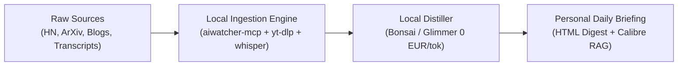

# High-Signal Radar: Sovereign Ingestion & Distillation Protocol

**Context**: How to cut through vendor marketing, hype loops, and cognitive fatigue without wasting hours watching 40-minute videos or doomscrolling aggregator feeds.

---

## The Core Philosophy: "Own the Ingestion, Let the LLM Read"
The goal of high-signal tracking is **asymmetric knowledge acquisition**: spend 10 minutes skimming structured, distilled signal instead of 3 hours watching filler.



---

## 1. Daily & Weekly Reading Stack

### Tier 1: Real Builders & Thinkers (High Signal)
* **Simon Willison's Weblog** ([simonwillison.net](https://simonwillison.net)): The definitive voice on agentic engineering patterns, LLM security (prompt injection), and sqlite/tools.
* **Hacker News (Algolia API / Top Distill)**: Trawled automatically by `aiwatcher-mcp` on scheduled cron; filters out corporate PR and prioritizes threads with 100+ comments on engineering tools.
* **Karpathy's Notes & GitHub Repos**: Grounded, minimalist architectures (`llm.c`, micrograd, nanoGPT) setting the simplicity bar.
* **Mitchell Hashimoto's Blog** ([mitchellh.com](https://mitchellh.com)): Ghostty, Zig, craftsmanship, and local desktop software architecture.
* **ArXiv CS.AI / CS.SE Repo Sweep**: Tracked via `arxiv-mcp` codehunt -- alerts on papers with verified GitHub repo releases and reproducible weights.

---

## 2. High-Signal Tech Creators (The "No Fluff" Rule)
Avoid generic 15-minute reaction videos. Target creators who demonstrate ground-truth code, hardware, or research:
* **George Hotz (tinygrad / comma.ai)**: Raw, unvarnished programming on bare-metal kernels and ML compilers.
* **Yannic Kilcher / Machine Learning Street Talk**: Deep technical paper breakdowns and mathematical epistemics.
* **The Primeagen / Low Level JavaScript**: Terminal-native programming, performance audits, and system architecture.
* **Andreas Kling (SerenityOS / Ladybird)**: Real native browser engine development from scratch in C++/Rust.
* **Ben Eater**: Physical electronics, 6502 breadboard computers, and network packet construction from copper wire.
* **Andrew Berman / In-Depth Tech Interviewers**: Long-form interviews with frontier founders (e.g., Sam Altman, Dario Amodei) that surface real roadmaps — **but mandate transcript-reading** to bypass the 20 minutes of pause-thinking, corporate hedges, and verbal filler.

---

## 3. The YouTube Video-Bypassing Protocol (Transcript Extraction)
Never watch a 30-minute tech talk to find the single architecture diagram. Let the local fleet extract the essence:

```powershell
# 1. Pull transcript directly (Zero Video Download)
yt-dlp --write-sub --sub-lang en --skip-download -o "transcript" "https://www.youtube.com/watch?v=VIDEO_ID"

# 2. Or transcribe offline via Whisper on local RTX 4090:
yt-dlp -x --audio-format mp3 -o "audio.mp3" "URL"
# Pass audio.mp3 to speech-mcp / whisper.cpp

# 3. Model Prompt (Bonsai / Glimmer):
# "Extract: 1. Core thesis/admissions; 2. Hard technical numbers/timeline dates; 3. Direct answers vs. evasive hedges; 4. Novel tools/repos mentioned. Strip all conversational pauses, ums/ahs, boilerplate intros, and sponsor banter."
```

---

## 🌏 4. Sinosphere Reality & Industrial Ground Truth (Anti-"Sinophobe Lies")
Cutting through western tabloid sensationalism, apocalyptic "China collapse" predictions, and state-sponsored hype. Focus strictly on on-the-ground engineering reality, supply-chain physics, and verified infrastructure.

### The Ground-Truth Principle
Western media headlines routinely misreport Chinese infrastructure out of sensationalism or technical illiteracy.
* **Case in Point**: The massive Motuo / Yarlung Tsangpo hydropower project in Tibet is widely misreported in western press as an "apocalyptic mega-dam blocking downstream rivers." Ground truth: it is an engineering **run-of-river cascading bypass tunnel** exploiting a 2,000m elevation drop through a horseshoe bend, **not a conventional reservoir blockage/dam**. 
* Always look for the engineering schematics, hydrology data, and spatial satellite mapping over opinion headlines.

### High-Signal Creators & Analysts (No "Rah-Rah", No Sensationalism)
* **Kyle Ellicott / Asianometry**: Deep technical, historically rigorous case studies on semiconductor fabrication (SMIC, ASML, Huawei), supply chain geopolitics, and industrial planning without political cheerleading.
* **On-the-Ground Tech & Infrastructure Observers** (e.g., *Walk East*, *Living in China*, *Jerry's Take on China*): Direct, unedited 4K walk-throughs of industrial manufacturing hubs (Shenzhen Huaqiangbei, EV gigafactories, automated high-speed rail terminals). Zero talking heads, just visual ground truth.
* **Geopolitical & Macro Physics (e.g., Cyrus Janssen, Daniel Dumbrill)**: Fact-checking mainstream press misrepresentations by citing original Ministry of Water Resources and State Grid whitepapers rather than third-hand editorial re-writes.
* **Hardware Sourcing & Shenzhen Maker Culture**: Tracking raw component evolution (RISC-V boards, Lidar sensors, Yahboom kits) directly from Taobao/Bilibili engineering channels.