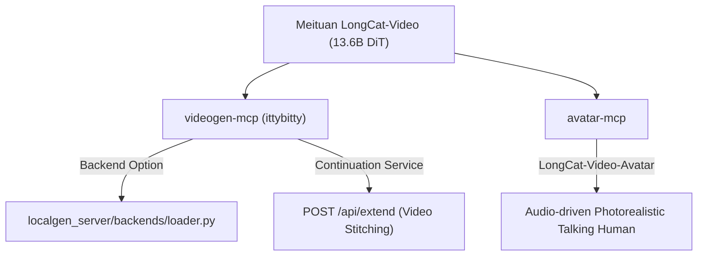

# Meituan LongCat-Video (13.6B DiT Engine)

**Last updated:** 2026-08-21 · **Model Repository:** [`meituan-longcat/LongCat-Video`](https://github.com/meituan-longcat/LongCat-Video) · **License:** MIT · **Fleet Target:** [`videogen-mcp`](../projects/videogen-mcp/README.md) (ittybitty)

LongCat-Video is an open-source, foundational video generation model developed by Meituan's LongCat team. Built on a 13.6-Billion parameter Dense Diffusion Transformer (DiT) architecture, it natively supports multi-task video generation including Text-to-Video (T2V), Image-to-Video (I2V), and seamless Video Continuation.

---

## Technical Specifications

| Parameter | Specification |
|---|---|
| **Architecture** | Dense Diffusion Transformer (DiT) |
| **Model Size** | 13.6 Billion parameters |
| **Native Output** | 720p (1280x720 / 720x1280) @ 30 FPS |
| **Key Capability** | Pretrained natively on **Video Continuation** for minute-long videos without color drift |
| **Framework Support** | PyTorch, Hugging Face `diffusers` (`meituan-longcat/LongCat-Video`), ComfyUI |
| **License** | MIT License |

---

## Fleet Architectural Placement

LongCat-Video is integrated into the fleet primarily via **`videogen-mcp`** (product name **ittybitty**), which serves as the central local video generation service and stock provider hub.



### Registered Backend in `videogen-mcp`
In `videogen-mcp`, LongCat-Video is available as the `longcat-video-13b` backend choice inside the `localgen_server` sidecar (port **8188**):

```python
# videogen_mcp.localgen_server.backends
"longcat-video-13b": {
    "model_id": "meituan-longcat/LongCat-Video",
    "label": "LongCat-Video 13.6B (DiT Video Continuation)",
    "tier": "2026",
    "fps": "30",
    "default_frames": "81",
    "default_steps": "40",
}
```

---

## VRAM & Memory Profiles

Running 13.6B DiT locally requires intelligent VRAM management:

| VRAM Tier | Strategy | Details |
|---|---|---|
| **24GB VRAM (RTX 4090 / 3090)** | `enable_model_cpu_offload()` | Model weights offloaded per block to CPU during sampling. |
| **16GB VRAM (RTX 4080 / 3080)** | `enable_sequential_cpu_offload()` + FP8 | Layer-by-layer offload; fits under 12GB VRAM allocation. |
| **System RAM** | Min 32GB RAM | Recommended for smooth CPU/GPU buffer swapping. |

---

## API Endpoints (`localgen-server`)

The `localgen-server` sidecar in `videogen-mcp` exposes two key endpoints for LongCat-Video:

### 1. Standard Generation (`POST /api/generate`)
```json
{
  "prompt": "Cinematic shot of a futuristic cyberpunk city at night with neon lights",
  "aspect": "16:9",
  "num_frames": 81,
  "guidance_scale": 4.5
}
```

### 2. Video Continuation (`POST /api/extend`)
Extends an existing video clip seamlessly using LongCat's native continuation conditioning:
```json
{
  "prompt": "The camera pans forward as rain begins to fall on the neon street",
  "video_b64": "<base64-encoded-mp4-input>",
  "num_extension_frames": 81
}
```

---

## FastMCP Agent Tools

When enabled in `videogen-mcp`, agents can invoke video generation tools:
* `videogen_generate_local(prompt, aspect, backend="longcat-video-13b")`
* `videogen_extend_clip(prompt, source_clip_path, num_frames=81)`

---

*Maintained by: Antigravity AI Fleet Orchestrator · 2026*
