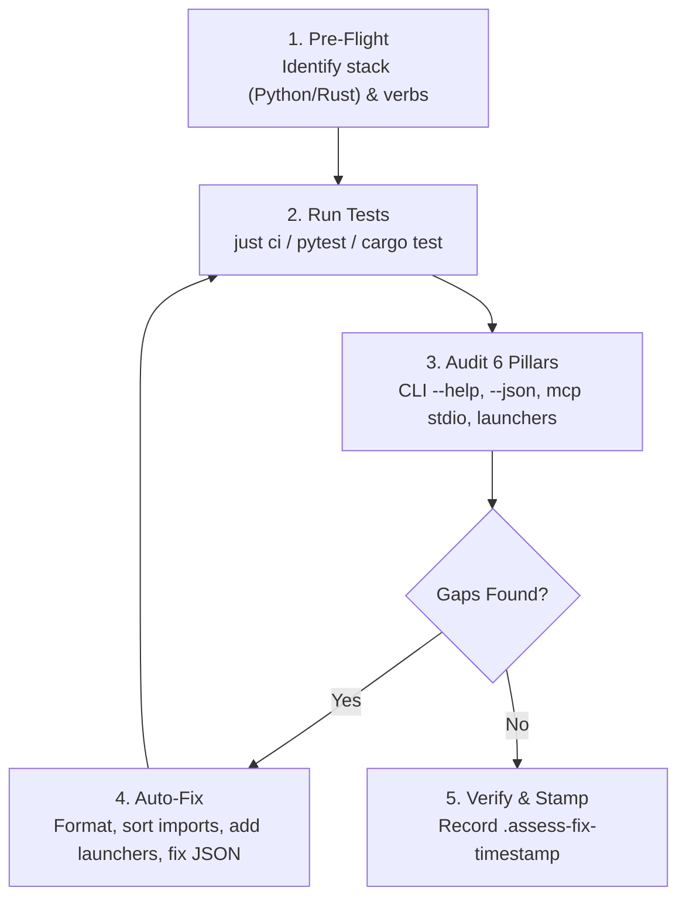

# Craft App Assess & Fix — SOP

**Trigger**: `assess and fix <craft-app>` (or auto-detected for any repo matching `*craft*` or adhering to the Craft Pattern)  
**Date**: 2026-11-04  
**Scope**: Verification, compliance audit, and automated fixes for the fleet's Craft-pattern application stable (`splatcraft`, `gamecraft`, `databasecraft`, `artcraft`, `djcraft`, `travelcraft`, `makercraft`, etc.).

---

## 0. Why a Dedicated Craft SOP?

Standard `-mcp` servers are daemon-shaped microservices (HTTP/SSE transport, dedicated ports in `WEBAPP_PORTS.md`, React/Vite frontends, `.mcpb` bundles). 

Craft apps are **fundamentally different**:
* **CLI-First**: One unified binary/entrypoint for humans and agents.
* **Stdio MCP**: Communication occurs via `stdio` (`<app> mcp --allow-path <DIR>`).
* **Document/Model-Centric**: Operates deterministically on input files and emits artifacts into `outbox/`.
* **Zero Web Port Requirement**: Craft apps do **not** run permanent background HTTP daemons; penalizing them for a missing port or missing Vite frontend is an invalid false positive.

---

## 1. Classification & Invalidation Rules

When a repository is classified as a **Craft App**:

| Standard MCP Check | Craft Action | Reason |
|---|---|---|
| `WEBAPP_PORTS.md` assignment | **WAIVED** | Craft apps communicate over `stdio` MCP or run native desktop GUIs. No daemon port required. |
| React/Vite frontend check | **WAIVED** | Unless the app explicitly targets Tauri/browser, headless CLI is primary. |
| `mcpb pack` bundle | **WAIVED** | Distributed as CLI binaries or uv packages, not zip bundles. |
| `glama.json` / Glama sync | **WAIVED** | Internal fleet / community tools do not publish to Glama registry. |

---

## 2. The 6 Pillars of Craft Health

Every Craft app is audited and scored across six core pillars:

### Pillar 1: CLI Surface & Help Completeness
* **Checks:**
  1. `<app> --help` exits `0`.
  2. `<app> --version` prints a semantic version string.
  3. Every sub-command/verb (`<app> <verb> --help`) exits `0`.
  4. Missing or invalid arguments produce clean error messages, **never raw uncaught Python tracebacks** or panics.

### Pillar 2: Machine Automation JSON (`--json`)
* **Checks:**
  1. All inspection/read verbs (`info`, `list`, `status`, `engines`) accept `--json`.
  2. When `--json` is supplied, stdout contains **only valid, parseable JSON** (no ANSI color escape codes, no Rich box characters).
  3. JSON output contains the core domain model keys (e.g. `splat_count`, `bbox`, `volume`, `format`).

### Pillar 3: Sandbox Confinement & Escape Resistance
* **Checks:**
  1. CLI and MCP server accept `--allow-path <DIR>` (or `--automation-read-root` / `--automation-write-root`).
  2. Attempting to read or write files outside the specified root exits non-zero with a structured confinement error.
  3. No hardcoded `C:\` paths in recipes or test fixtures.

### Pillar 4: Stdio FastMCP Bridge
* **Checks:**
  1. `<app> mcp` starts a FastMCP server listening on standard input/output.
  2. Sends JSON-RPC `{"jsonrpc": "2.0", "method": "tools/list", "id": 1}` and verifies response within 5 seconds.
  3. Tools exposed over MCP map 1:1 to the primary CLI verbs.

### Pillar 5: Democraft Integration & Headless Recipes
* **Checks:**
  1. App is registered in `democraft-mcp/src/democraft_mcp/crafts.py` (or local recipe harness).
  2. Provides **$\ge 3$ reproducible headless recipes** that write to `outbox/<app>/<demo>/`.
  3. Each recipe run produces a `run.json` (with execution timings and model metrics) and a `*-report.md`.
  4. CI never depends on live GPU training or external paid APIs without graceful `down`/`skip` receipts.

### Pillar 6: Double-Click Launchers & Instacrash Guards
* **Checks:**
  1. Repo contains `start.bat` and `start.ps1`.
  2. Launcher contains the **instacrash guard**:
     ```bat
     if errorlevel 1 (
       echo [app] start.ps1 exited with error - window held open
       pause
       exit /b 1
     )
     ```
  3. Fleet launcher exists at `mcp-central-docs/starts/<app>-start.bat` and delegates properly.

---

## 3. Assess & Fix Execution Protocol

When triggered to `assess and fix` a craft app:



### Automated Fix Procedures:
1. **Fix CLI `--json` pollution:** Strip Rich console markup or route formatted tables to stderr so stdout remains purely parseable JSON when `--json` is passed.
2. **Fix Missing Launchers:** Generate standard `start.bat`, `start.ps1`, and `mcp-central-docs/starts/<app>-start.bat`.
3. **Fix Import & Lint Drift:** Run `just format` or `ruff check --fix . && ruff format .` (Python) / `cargo fmt && cargo clippy` (Rust).
4. **Fix Missing AGENTS.md:** Ensure per-repo `AGENTS.md` exists and defines the craft's domain model, verbs, and confinement roots.

---

## 4. Verification & Timestamp

Once all 6 pillars pass:
1. Run `just ci` (or `pytest`/`cargo test`) to ensure a 100% green test suite.
2. Write `.assess-fix-timestamp` with the current UTC ISO timestamp at the repository root.
3. Emit a concise summary table:
   * **CLI Verbs**: Verified count
   * **JSON Automation**: Verified
   * **Stdio MCP**: Verified
   * **Launchers**: Verified
   * **CI Status**: Green
