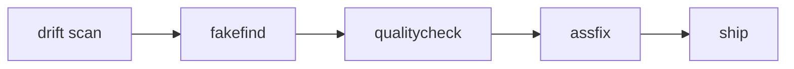

# The Solo Fleet Builder Superpower

**Tags:** fleet, assfix, macros, solo-dev, token-economics  
**Audience:** One person maintaining dozens of MCP repos under `D:\Dev\repos`  
**Related:** [agentic_macros.md](../standards/rules/agentic_macros.md), [repo-assess-and-fix.md](repo-assess-and-fix.md), [DRIFT_SCAN_SOP.md](DRIFT_SCAN_SOP.md)

---

## The problem nobody talks about

Platform teams with ten engineers have runbooks, on-call rotation, and CI police. A solo fleet builder has **fifty repos**, **months of drift**, and **one brain** that cannot re-decide "what does good look like?" every time they open a folder they haven't touched since spring.

The repos are not trash. They are **underlinted, underdeveloped, and not quite aligned** with the standards that evolved while they sat idle. The "popular" repos (the ones you touch weekly) feel fine. The long tail feels like guilt in directory form.

That asymmetry is normal. The mistake is treating all fifty like a fresh greenfield, or trying to batch-fix them with one script and one prayer.

---

## The superpower (hidden in plain sight)

The fleet already has **agentic macros + SOPs**: named utterances that expand into multi-phase procedures, with checklists in `mcp-central-docs/patterns/` and thin **skills** (assfix, drift-scan, fakefind, quality-check) that route agents to the right doc.

This is **ops-as-code for agents**:

| You say | It means |
|---------|----------|
| `drift` | Read-only fleet triage — *which* repos hurt, no edits |
| `fakefind <repo>` | Is the webapp real or gaslighting? Report only |
| `qualitycheck <repo>` | Should this repo *exist*? Strategic verdict |
| `assfix <repo>` | Full mechanical pass — assess, fix, lint, docs, pack, push |
| `assfixstat` | Scoreboard — fixed vs unfixed via `.assess-fix-timestamp` |

**assfix** answers: *Does this repo meet the bar?*  
**qualitycheck** answers: *Is this repo worth keeping?*

Keeping those separate is the insight. Merge them and you get shallow SOTA scores or hand-wavy archive advice with no evidence.

### Why it works for one person

1. **Utterance → procedure, not vibes.** "assfix foo-mcp" is not "please be thorough." It is Phase 0–6 with phase gates (report before fix, ruff before push).

2. **Single source of truth.** SOPs live in central docs; skills are routers. OpenCode, Cursor, and Claude Desktop can share the same checklist without forking it per IDE.

3. **One repo, full gate, move on.** Batch mutation across repos is how you get inconsistent damage. The macro explicitly wants one repo through Phase 6 before the next.

4. **Progress you can see.** `.assess-fix-timestamp` turns "I should fix the fleet someday" into "12 done, 38 queued."

5. **Leverage over heroics.** You are not manually linting fifty trees. You are running a **named pipeline** that already encodes fleet decisions (CORS, port registry, session injection, MCPB, webapp SOTA).

---

## A realistic campaign (fifty stale repos)

Do not assfix everything to full parity on day one. Triage in tiers:

| Tier | Profile | Action | Typical effort |
|------|---------|--------|----------------|
| **A** | Active, user-facing, "popular" | Full **assfix** → ship | Half day each |
| **B** | Useful but dormant | CRITICAL + HIGH only, timestamp, skip MCPB if `.nopublish` | Hours |
| **C** | Duplicate, experiment, autoscrape | **qualitycheck** → archive or mark `.nopublish` | Minutes |

**Recommended sequence for one repo:**

```
drift (fleet queue) → qualitycheck? (if sketchy) → assfix → assfixstat
```

For a dormant repo you still believe in: **assfix one**, get it near parity with a popular reference repo (same vintage of `justfile`, `llms-full.txt`, webapp stack, port in WEBAPP_PORTS.md), then stop. Perfection is optional; **drift closure** is the goal.

---

## The chain (fleet hygiene pipeline)



- **drift** — where to spend attention (worst-first)
- **fakefind** — don't polish fake UI
- **qualitycheck** — don't assfix repos you'd archive
- **assfix** — mechanical compliance
- **ship** — release when Tier A warrants it

---

## Token frugality — read this before you assfix the fleet

Full **assfix** is high-leverage and **high-cost**. A single run on a large repo can consume substantial context: nineteen assessment categories, multi-file fixes, lint loops, doc sync, optional MCPB. Running assfix on fifty repos in one weekend is a token bonfire and a context-window cliff.

### When to use full assfix

- Repo is Tier A or high-value Tier B
- You are closing drift before a release or demo
- The repo will be touched again within weeks
- You need `.assess-fix-timestamp` for fleet accountability

### When **not** to use full assfix

| Situation | Use instead |
|-----------|-------------|
| One-line bugfix | Fix the bug, run `gates green` or `lint green` |
| "Is this repo worth keeping?" | **qualitycheck** only (read-only) |
| "Which repos are worst?" | **drift** only (read-only) |
| Tier C / likely archive | **qualitycheck** → archive, skip assfix |
| Partial drift (missing README only) | Targeted edit or `update docs` macro |
| You already assfixed this month | Spot-check gates; don't re-run Phase 1–6 |

### Frugality rules of thumb

1. **Never batch-assfix in one chat.** One repo per session (or per assfix invocation). Queue with drift; execute serially.

2. **Read-only first.** drift + qualitycheck + fakefind do not edit files. Cheap triage saves expensive full passes on dead weight.

3. **Tier B shortcut.** Say explicitly: "assfix foo-mcp CRITICAL and HIGH only" if the SOP allows stopping early — don't silently run the full packaging phase on a `.nopublish` side project.

4. **assfixstat before assfix.** Know what's done; don't re-assess repos that are fresh.

5. **Reference one golden repo.** Compare against a "popular" sibling instead of re-deriving standards from scratch each time (e.g. mdm, arxiv-mcp).

6. **Macros are not magic words.** Saying `assfix` for a typo is like running `terraform apply` to change a comment. Match tool to task.

---

## What this is not

- Not a replacement for **thinking** about architecture (qualitycheck handles keep/kill, not design).
- Not license to **invent** checks outside [repo-assess-and-fix.md](repo-assess-and-fix.md).
- Not **parallel fleet scripts** — the fleet docs explicitly warn against bulk edits across repos.
- Not **free** — token and time budget like any large refactor.

---

## One-line summary

**Solo fleet maintenance at scale = named macro pipelines + central SOPs + serial assfix campaigns + ruthless triage — and the discipline to not fire a six-phase audit at a one-line fix.**

Poor lonesome you, running the shipyard alone — but this is the lever that makes fifty repos a queue instead of a nightmare.

---

## Quick reference

| Artifact | Path |
|----------|------|
| Macro registry | `standards/rules/agentic_macros.md` |
| assfix SOP | `patterns/repo-assess-and-fix.md` |
| drift SOP | `patterns/DRIFT_SCAN_SOP.md` |
| fakefind SOP | `patterns/FAKEFIND_AUDIT_SOP.md` |
| assfix skill | `skills/assfix/SKILL.md` |
| Progress markers | `.assess-fix-timestamp` per repo |

**Triggers:** `drift` · `assfix <repo>` · `assfixstat` · `qualitycheck <repo>` · `fakefind <repo>`
