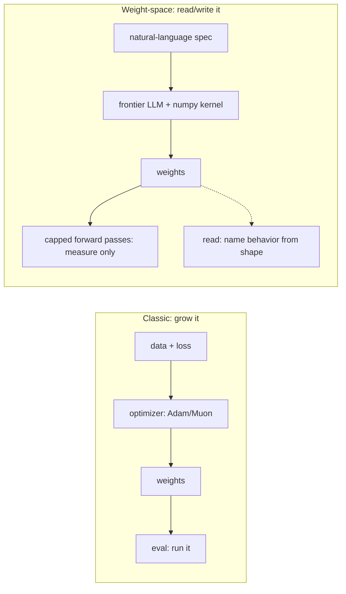
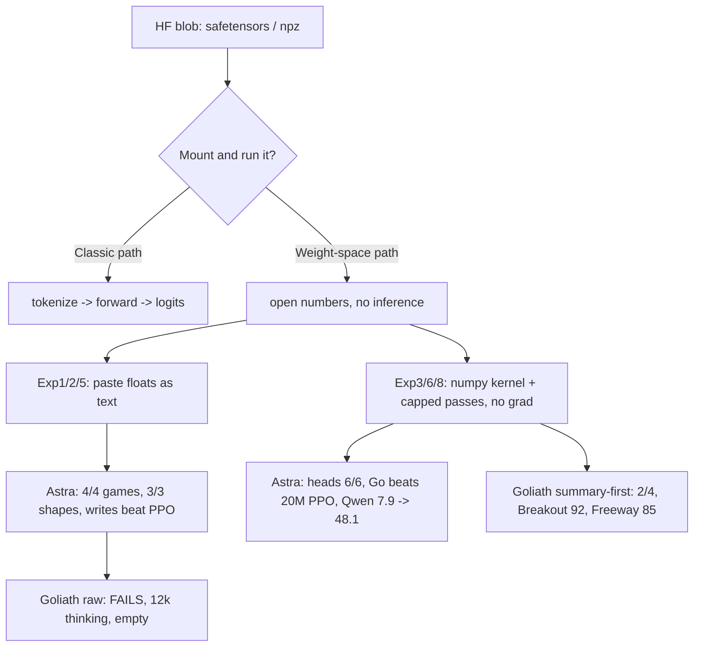
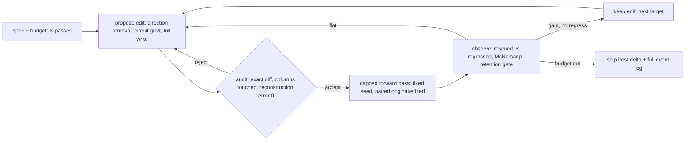
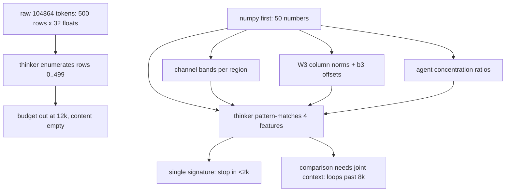
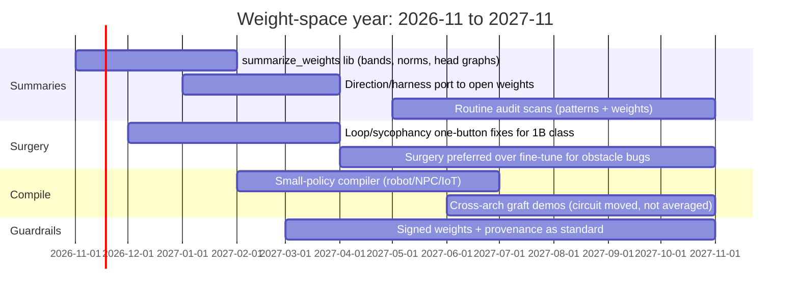
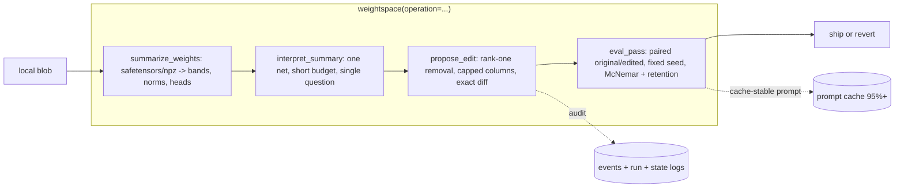

# Weight-Space Programming: Twelve-Month Forecast (with diagrams)

**Date:** 2026-11-03 (Europe/Vienna) | **Type:** Forecast, not measurement. Companion to `2026-11-03-weight-space-programming-local-replication.md` (measured).
**Horizon:** 2026-11-03 -> 2027-11-03. All future claims are guesses with reasons, not predictions with dates.
**Rule:** numbers from tonight are in the companion doc. Nothing here invents new measurements.

## 0. The one picture

Classic deep learning moves weights with gradients. Weight-space programming moves weights with language.

The second loop already works at 17k-1.5M scale and 0.8B repair scale. The question for the year is how far up each axis it climbs.

## 1. Where we stand tonight (measured, not forecast)

Key asymmetry from our runs: single-signature nets finish fast (Breakout left/right 10.93/8.92, Freeway b3_up +3.14), comparison pairs (Pong-vs-PacMan) ruminate past 8k tokens. The year ahead is mostly about removing that asymmetry with better summaries, not bigger models.

## 2. The three capability lines and their ceilings

```mermaid
flowchart TD
  subgraph READ["READ: name behavior from shape"]
    R_NOW[now: 17k PPO, 24k diffusion, 7M LM blocks, 270M sycophancy-with-patterns]
    R_NEXT[3-6 mo: standard summarize_weights lib, head graphs, direction lists]
    R_YEAR[12 mo: routine audit scan, some backdoors found without evals]
  end
  subgraph FIX["FIX: tiny surgery, no retrain"]
    F_NOW[now: 3.5% car-ramp 0->1024, 0.016% Qwen loop delete 6x math]
    F_NEXT[3-6 mo: loop/sycophancy/refusal buttons for local 1B class]
    F_YEAR[12 mo: surgery preferred over fine-tune for obstacle-class bugs]
  end
  subgraph WRITE["WRITE: compile behavior to weights"]
    W_NOW[now: 20k MinAtar beats weak PPO, 1.5M Go beats equal PPO at 50 passes]
    W_NEXT[3-6 mo: robot/IoT/NPC controllers compiled, not trained]
    W_YEAR[12 mo: small-policy compiler exists; frontier-scale write still fails]
  end
  R_NOW --> R_NEXT --> R_YEAR
  F_NOW --> F_NEXT --> F_YEAR
  W_NOW --> W_NEXT --> W_YEAR
```

What does NOT move in a year (our priors): writing a frontier-scale model from nothing (coherence, not context, is the wall), and creating capability where none exists (Gemma control: 6.8 -> 7.7 max; surgery unblocks, it does not invent).

## 3. The harness loop that eats the year

Every agentic result (Exps 6/8) runs the same loop. The loop, not the model, is the product.

Fleet note: keep the prompt cache-stable across turns (their 96% cached-input rate is load-bearing), forbid autograd/numpy-training imports in the kernel, log every pass like they do (events.jsonl + run.json + state.json). The benchmark they promise standardizes OBS so results compare.

## 4. Why summary-first wins locally (tonight's mechanism)

Design rule for the fleet tool: one net per call, explicit feature names in the prompt, short budget, never N-way open comparison. NET1 and NET4 prove the HIT path; NET2/NET3 prove the MISS path. Next experiment (in companion doc s10): single-feature prompts to find the minimal sufficient summary.

## 5. Twelve-month roadmap (guess with milestones)

Milestones are falsifiable: (a) 4/4 Exp1 locally under 2k tokens via summaries; (b) one-button loop fix reproduced on a second loopy 1B; (c) one compiled controller deployed on real hardware; (d) one audit finding that evals missed. If none fire by mid-2027, the paradigm stalled at demo scale.

## 6. Fleet integration (when it earns a repo)

No repo now (per gate). When milestones fire, the shape is:

Portmanteau, cache-stable prompts, tool_free-style audit, CPU-only kernel, no autograd. Webapp only if it earns one (Dashboard + Inbox + Tools + Skills + Chat + Settings + Help + Logs per SOTA, none before the module proves 4/4 + one real fix).

## 7. Risks worth naming early

- Theft without data: reading behavior from weights lowers the cost of cloning small controllers. Treat weight blobs like source code.
- Invisible edits: a 0.016% change that 6x's math also 6x's whatever the attacker wants. Unsigned weights stop being acceptable once surgery is cheap.
- False confidence: 2/4 tonight is the honest number. Any roadmap slide that says 4/4 locally today is lying. Keep the companion doc's "NOT claimed" list attached to every forecast.

## 8. Slow summary

The miracle is real and receipted; the wonder is that it is legible. Paddle at the bottom, up is +3.14, never-stand-still is -0.87 — intent carved in numbers, readable without running. In a year the carving gets a standard magnifying glass, surgery beats retraining for the obstacle class, small behaviors compile like code, and the frontier still cannot write itself from nothing. The fleet's job is the magnifying glass, not the miracle.
