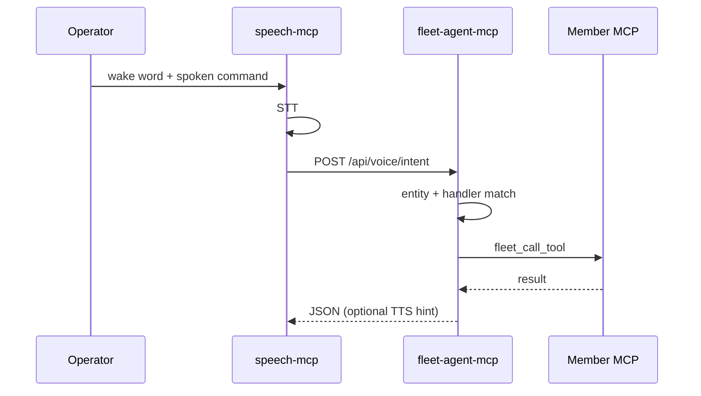

# Voice Command Bus (Fleet v1)

**Status:** Official fleet pattern (June 2026)  
**Canonical registry:** [`../config/voice_command_bus.yaml`](../config/voice_command_bus.yaml)  
**Ingress:** [speech-mcp](file:///D:/Dev/repos/speech-mcp) (wake word + utterance STT)  
**Router:** [fleet-agent-mcp](file:///D:/Dev/repos/fleet-agent-mcp) (`POST /api/voice/intent`, `route_voice_intent`)  
**Members:** alexa-mcp, yahboom-mcp, and any MCP registered in the fleet bridge

---

## 1. Purpose

Speech is **fleet infrastructure**, not a feature of a single MCP server. One always-on microphone pipeline detects a **wake word**, captures the **operator command**, transcribes it, and **delegates** to the correct fleet member.

Example:

> **wakeywakey** — *"boomy go on patrol and report what you found"*

| Step | Component | Action |
|------|-----------|--------|
| 1 | speech-mcp | openWakeWord hears `wakeywakey` |
| 2 | speech-mcp | Records ~6s utterance, STT (FunASR when enabled) |
| 3 | speech-mcp | `POST` **SpeechIntent** to fleet-agent |
| 4 | fleet-agent | Resolves entity `boomy` → server `yahboom` |
| 5 | yahboom-mcp | `yahboom_agent_mission(goal=…, speak=true)` |
| 6 | yahboom + speech | Mission status / findings → optional TTS via speech-mcp |

alexa-mcp keeps **acoustic loop** duties (TTS → Echo → mic → STT of Alexa’s reply). It does **not** own wake-word detection.

---

## 2. Architecture



### 2.1 Separation of concerns

| Layer | Owns | Must not own |
|-------|------|----------------|
| **speech-mcp** | Mic, wake word, command capture, STT, TTS playback | Robot motors, Alexa API, mission planning |
| **fleet-agent-mcp** | Entity registry, routing, `fleet_call_tool`, dev-workflow commands (`dev_ops`) | Exclusive mic access |
| **Member MCP** | Domain tools (`interact`, `yahboom_agent_mission`, …) | Wake word models |

---

## 3. SpeechIntent payload

`POST /api/voice/intent` body:

```json
{
  "wake": "wakeywakey",
  "transcript": "boomy go on patrol and report what you found",
  "timestamp": "2026-06-01T14:00:00+00:00",
  "source": "speech-mcp"
}
```

Response:

```json
{
  "success": true,
  "entity": "boomy",
  "server": "yahboom",
  "tool": "yahboom_agent_mission",
  "message": "Delegated to yahboom/yahboom_agent_mission",
  "data": { }
}
```

---

## 4. Entity registry

Edit [`config/voice_command_bus.yaml`](../config/voice_command_bus.yaml):

- **wake_words** — maps logical name → openWakeWord model (or custom ONNX path in speech-mcp env)
- **entities** — `boomy`, `alexa`, `fritz`, … with **aliases** and **server** bridge key
- **handlers** — per-entity keyword rules and `{remainder}` / `{transcript}` templates

Unknown entity with no keyword match: fleet-agent returns `success: false` with routing hints.

---

## 4b. Dev-workflow voice commands (fritz)

`fritz` doubles as the **dev-command entity**: spoken commands route in-process
to fleet-agent's `dev_ops` portmanteau (`src/fleet_agent/mcp/tools/dev.py`) —
no HTTP hop to the bridge.

`router.default_entity: fritz` in the registry means **bare commands work**
without an entity word: *"gpu status"*, *"start webapp arxiv"*, *"set timer…"*
all resolve to fritz. Entity words still win when spoken (boomy/alexa).

| Spoken phrase (after wake) | Target | Action |
|---|---|---|
| *"fritz start webapp arxiv"* (or bare *"start webapp arxiv"*) | `dev_ops.start_webapp` | Resolves `mcp-central-docs/starts/{repo}-start.bat` via the Fleet Starts Launcher (`POST http://127.0.0.1:10791/api/launch`); falls back to a direct detached spawn when the launcher is down |
| *"fritz gpu status"* | `dev_ops.gpu_status` | `nvidia-smi` snapshot — per-GPU load, VRAM used/total, temperature (spoken back) |
| *"fritz kick invokeai"* | `dev_ops.invokeai_kick` | `POST http://127.0.0.1:11154/api/invokeai/engine/start` on invokeai-mcp |
| *"fritz invokeai status"* | `dev_ops.invokeai_status` | Engine running/stopped state from invokeai-mcp |
| *"fritz list webapps"* | `dev_ops.list_webapps` | Catalog of startable webapps (spoken count + routing hint) |
| *"opencode assfix devices, run"* | `dev_ops.opencode_send` | Sends the task to the **most recently active opencode session** (the one open in the TUI) via opencode-cli-mcp `opencode_send_message` |
| *"set timer twenty minutes, then play desguello"* | `voice_assist` | Clause split on "then"/"and": timer → speech-mcp `manage_domestic_utility` (announces expiry aloud), *"play X"* → Plex REST search → **direct part stream** (`/library/parts/…/file.mp4`) → **VLC** (`FLEET_VLC_PATH` override; Plex client fallback). The HLS transcode endpoint (`start.m3u8`) returns 400 for ad-hoc URLs — do not use it |

The spoken repo phrase is tolerant (`"start webapp arxiv"`, `"launch webapp plex"`,
filler words stripped); `dev_ops` matches it against start-script shortnames.
Duration words and digits are parsed (`twenty minutes` → 1200s).

**Environment (fleet-agent):**

| Variable | Default | Meaning |
|----------|---------|---------|
| `FLEET_STARTS_UI_URL` | `http://127.0.0.1:10791` | Fleet Starts Launcher base URL |
| `FLEET_STARTS_DIR` | `D:\Dev\repos\mcp-central-docs\starts` | Local fallback scan dir |
| `FLEET_DEV_INVOKEAI_URL` | `http://127.0.0.1:11154` | invokeai-mcp REST base URL |
| `FLEET_VLC_PATH` | auto-detect | VLC executable for Plex playback (common install paths checked) |
| `PLEX_BASE_URL` / `PLEX_TOKEN` | — | Plex server + token for direct REST search/stream (user env or `.env`) |

**Environment (speech-mcp):**

| Variable | Default | Meaning |
|----------|---------|---------|
| `FLEET_VOICE_DELEGATE` | `1` when URL set | Enable post-wake capture + route |
| `FLEET_VOICE_AUTOSTART` | `1` | Start the wake listener at backend boot (HTTP mode) |
| `FLEET_VOICE_WAKE_KEYWORD` | `hey_jarvis` | openWakeWord model name (production target `wakeywakey` custom ONNX) |
| `FLEET_VOICE_WAKE_GREETING` | `Hello, mistress.` | Spoken ack after wake, before capture (empty = silent) |
| `FLEET_VOICE_SLEEP_KEYWORD` | `hey_mycroft` | Second model that **stops the listener** — stock placeholder until a custom `sleepsleep` ONNX is trained; saying *"{wake word}, sleepsleep"* also stops it |
| `FLEET_VOICE_SPEAK_REPLY` | `1` | Speak routed results back; `0` mutes |

**Daily loop:**

```
(backend boots with FLEET_VOICE_DELEGATE=1 -> listener auto-starts)
"wakeywakey"           -> "Hello, mistress." (greeting)
"fritz gpu status"     -> captures 6s, STT, routes -> "OK. RTX 4090: 12% load, ..."
"opencode assfix devices, run" -> opencode TUI session gets the task
"set timer twenty minutes, then play desguello" -> timer + Plex (in VLC)
"sleepsleep"           -> "Going to sleep." (listener stops; restart via MCP tool)
```

Manual control: `configure_local_wake_word(action="start" | "stop" | "status")`.

---

## 4c. Receivers (entity roster)

Every voice **receiver** is an entity in `voice_command_bus.yaml`: alias match
wins over the default entity, so *"dreame go home"* never reaches fritz.

| Receiver | Entity | Aliases | Server | Example commands |
|---|---|---|---|---|
| **Fritz** — universal agent | `fritz` | fritz, lumen | fleet-agent (local) | *"fritz gpu status"*, *"set timer…"*, anything unmatched |
| **opencode** — dev IDE | `opencode` | opencode, open code | fleet-agent (local) | *"opencode assfix devices, run"* → open opencode session |
| **Boomy** — Yahboom car | `boomy` | boomy, raspbot, yahboom, robocar | yahboom | *"boomy go on patrol"* |
| **Teleop** — WebXR gateway | `teleop` | teleop, teleoperator, vr teleop, headset | teleoperator | *"teleop emergency stop"*, *"teleop take over"*, *"teleop look left"*, *"teleop start video"* |
| **Dreame** — D20 Pro robovac | `dreame` | dreame, vacuum, robohoove, hoover, robovac | dreame | *"dreame clean the kitchen"*, *"dreame go home"*, *"dreame find yourself"*, *"dreame status"* |
| **Calibre** — ebook library | `calibre` | calibre, caliber | fleet-agent (local → calibre-mcp) | *"calibre find neuromancer"*, *"calibre open dune"*, *"calibre recent"* — spoken verbs stripped before search |
| **Plexy** — movie + audiobook player | `plexy` | plexy, plexie, plex | fleet-agent (local → Plex REST → VLC) | *"plexy play inception"* (VLC), *"plexy pause"*, *"plexy next"*, *"plexy find hitchcock"* |
| **Alexa** — Echo acoustic loop | `alexa` | alexa, echo | alexa | *"alexa set a timer"*, anything Echo-native |
| **Japanophile** — Japanese learning workstation | `japanophile` | japanophile, nihongo | japanophile (direct, no NLP) | *"japanophile kanji water"*, *"japanophile vocab arigatou"*, *"japanophile quiz"*, *"japanophile knowledge"* — bare wake with no keyword match → `japanophile_help` |

- `dreame`/`boomy`/`alexa`/`japanophile` route straight to their MCP server
  (`dreame_tool`, `kanji`/`vocab`/`jlpt`/`knowledge`, …) — no NLP hop needed
  when the target tools are simple `portmanteau(operation, query)` calls.
  `plexy`, `calibre`, and `opencode` use fleet-agent local tools
  (`voice_assist`, `dev_ops`) because they need multi-step logic
  (search → pick → play; verb stripping; session discovery → send).
- **`japanophile` (added 2026-09-15) is registered but not yet functional**:
  japanophile-mcp's `/mcp` streamable-HTTP mount currently fails session
  init (`McpError: Session terminated`, verified with the real FastMCP
  Client, not just curl) — `fleet_call_tool` can't reach it until that's
  fixed. The registry/FLEET_SERVERS entries are correct and ready; only the
  target server's own `/mcp` mount needs fixing.
- `teleop` routes to `teleoperator`'s `teleop_voice_command`, which maps STT
  transcripts to domain actions deterministically (estop, takeover, mode,
  gaze, LiveKit, status) — no LLM on the hot path.
- Bridged tool payloads (markdown telemetry, JSON dicts) are summarized by the
  router for spoken replies — no "Called X on Y" chatter.
- **Adding a receiver** = one `entities` block + one `handlers` block in
  `voice_command_bus.yaml`, plus a `FLEET_SERVERS` row in
  `fleet-agent-mcp/src/fleet_agent/mcp/tools/fleet_bridge.py` when the target
  server is not registered yet.

## 5. Operations (Windows fleet)

### 5.1 Long-running services

| Service | Port | NSSM / Headless |
|---------|------|-----------------|
| speech-mcp backend | **10909** | **Yes** — wake listener lives here |
| speech-mcp frontend | 10908 | No (dev UI only) |
| fleet-agent-mcp | **10996** | **Yes** — voice router HTTP |
| alexa-mcp backend | 10801 | On demand or always-on for dashboard |
| yahboom-mcp | 10892 | On demand; robot must be reachable when routed |

Use [`FleetStartMode.ps1`](./FleetStartMode.ps1): **`-Headless -BackendOnly`** for NSSM (see [`FLEET_EXECUTION.md`](./FLEET_EXECUTION.md)).

### 5.2 Environment

**speech-mcp**

| Variable | Default | Meaning |
|----------|---------|---------|
| `FLEET_VOICE_ROUTER_URL` | `http://127.0.0.1:10996/api/voice/intent` | Delegation target |
| `FLEET_VOICE_DELEGATE` | `1` when URL set | Enable post-wake capture + route |
| `FLEET_VOICE_COMMAND_SECONDS` | `6` | Utterance record window |
| `FLEET_VOICE_WAKE_KEYWORD` | `hey_jarvis` | openWakeWord model name until `wakeywakey` ONNX exists |

**fleet-agent-mcp**

| Variable | Default | Meaning |
|----------|---------|---------|
| `FLEET_VOICE_REGISTRY` | path to central YAML | Override registry location |

### 5.3 Mic contention

Only one process should hold the default capture device for **wake + command**. Pause speech wake while alexa-mcp runs a long `listen_for_response`, or use separate input devices. Document device IDs in member READMEs.

### 5.4 Custom wake word `wakeywakey`

Train or export an openWakeWord-compatible ONNX; register in YAML under `wake_words.wakeywakey`. Until then, dev can use `hey_jarvis` with the same pipeline.

**Do not** use openWakeWord’s stock `alexa` model as the operator wake if an Echo is in the same room.

---

## 6. Member integration checklist

- [ ] Listed in `fleet_bridge.FLEET_SERVERS` with correct `/mcp` URL ([`WEBAPP_PORTS.md`](../operations/WEBAPP_PORTS.md))
- [ ] Handler entry in `voice_command_bus.yaml`
- [ ] README pointer to this standard
- [ ] Tools idempotent where possible (voice may repeat commands)

---

## 7. Related standards

- [WEBAPP_LOGS_PAGE.md](./WEBAPP_LOGS_PAGE.md) — operator logs for routed actions (`kind: bridge`, `interaction`, `tool_call`)
- [DIALOGIC_RETURNS.md](./DIALOGIC_RETURNS.md) — multi-turn UX after delegation
- [YAHBOOM_ROBOTICS_STANDARD.md](./YAHBOOM_ROBOTICS_STANDARD.md) — Boomy missions and ROS topics

---

*Tags: #voice #speech-mcp #fleet-agent #wake-word #orchestration*
